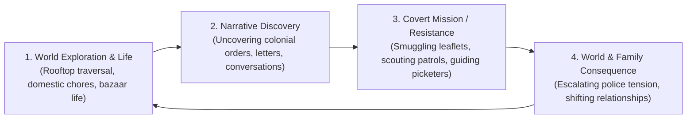

# PROJECT REVOLUTION — Game Design Document (GDD)

**Project Title:** REVOLUTION  
**Genre:** Third-person, story-driven historical open-world action-adventure  
**Setting:** Kot Gurdarshan, Central Punjab, British-ruled India (1919 – 1929)  
**Visual Style Target:** Grounded Historical Realism (Red Dead Redemption 2 visual benchmark)  
**Document Status:** Approved Direction by Project Owner  
**Version:** 1.0.0  
**Date:** October 10, 2026  

---

## 1. Executive Summary & Creative Vision

**REVOLUTION** is a cinematic, emotionally profound historical open-world action-adventure set in the fictional Punjabi town of **Kot Gurdarshan** during the most volatile decade of India's independence struggle (1919 – 1929).

The player experiences the world through **Kabir**, who begins the journey as an innocent 12-year-old boy living with his family of master tailors and artisans. Through an unhurried, lived-in childhood, the player discovers domestic warmth, friendship, and cultural beauty—contrasted sharply against the systemic brutality of the British colonial regime following the Rowlatt Act and 1919 martial law.

Over a 10-year narrative span, Kabir matures into a 21-year-old young man who becomes an integral courier, scout, and protector in the underground freedom movement. The game combines agile rooftop traversal, grounded stealth, investigative discovery, and moral courage without turning into an unrealistic arcade shooter.

---

## 2. Core Pillars

1. **Grounded Historical Authenticity:**
   - Deeply researched material culture, architecture, and colonial administration. Real historical events (Rowlatt Act, Non-Cooperation, Simon Commission) form the backdrop, while the central cast and town are original.
2. **The RDR2 Visual & Atmospheric Benchmark:**
   - Naturalistic lighting, volumetric dust/fog, tactile material weathering (chipped lime plaster, salt efflorescence on baked brick, frayed khadi, mud splatters), and dynamic weather states (scorching summer, monsoon deluge, winter mist).
3. **Organic Character Growth & Evolving Perception:**
   - The world evolves alongside the protagonist. Early mechanics emphasize childhood agility (kite flying, slipping through tight alleys, fetching errands). Later mechanics emphasize stealth, covert courier delivery, intelligence gathering, and evading armed colonial police.
4. **Vulnerability Over Fantasy:**
   - A young Indian boy cannot overpower an armed British infantryman or police platoon in hand-to-hand combat. Tension comes from stealth, agility, rooftop paths, distraction, and wit.

---

## 3. Core Gameplay Loop

---

## 4. Setting & District Breakdown

Kot Gurdarshan is an interconnected $1.8\text{ km}^2$ region divided into seven distinct districts:
- **District A: Mohalla Darzian (Family Neighborhood):** Three-story brick townhouses, carved wooden balconies (*jharokhas*), open courtyards (*aangans*), and flat interconnected rooftops (*chhats*).
- **District B: The Grand Bazaar & Grain Mandi:** Sensory hub of commerce, spice stalls, cloth merchants, and grain weighing yards.
- **District C: The Vernacular Middle School:** Colonial classroom compound, King George V portraits, playground banyan tree.
- **District D: The Canal Colony & Countryside:** Upper Bari Doab irrigation canal, wheat and golden mustard (*sarson*) fields, brick kilns.
- **District E: The Railway Junction & Locomotive Shed:** The industrial iron dividing line of the town; platforms, freight sidings, and repair sheds.
- **District F: The Colonial Civil Lines & Cantonment:** Segregated imperial zone of white stone bungalows, wide macadam avenues, the District Court, and the European Club.
- **District G: The Outer Margins & Old Caravanserai:** 17th-century Mughal ruins housing an underground cyclostyle printing press.

---

## 5. Traversal & Stealth Mechanics

1. **Rooftop Highway (*Chhat Traversal*):**
   - Flat Punjabi brick rooftops provide an authentic, culturally accurate vertical traversal layer. Kabir can vault parapets, hop across washing lines, climb drainpipes, and drop into secluded courtyards to bypass ground-level police curfews.
2. **Social Stealth & Blending:**
   - Carrying a bolt of dyed cloth or a tiffin carrier allows Kabir to pass through normal bazaar checkpoints without suspicion.
3. **Eavesdropping & Investigation:**
   - Crouching beside wooden *jharokha* lattices or peering through courtyard skylights allows Kabir to overhear vital colonial conversations, magistrate orders, and town rumors.

---

## 6. Revision History
| Version | Date | Author | Status | Notes |
| :--- | :--- | :--- | :--- | :--- |
| 1.0.0 | 2026-10-10 | Senior Technical Director & Creative Lead | **Approved** | Setting locked to Central Punjab 1919–1929 (Kot Gurdarshan) with RDR2 visual baseline. |
