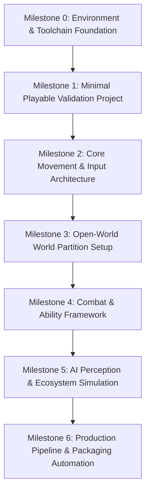

# PROJECT REVOLUTION — Technical Roadmap

> **Document Version:** 1.0.0  
> **Target Engine:** Unreal Engine 5 (Stable release 5.4.x / 5.5.x)  
> **Development Model:** Progressive System Introduction & Rigorous Validation  

---

## 1. Technical Vision & Architecture Principles
1. **Rock-Solid Foundation First:** No gameplay or open-world assets before verified engine, C++ compilation, and source control pipelines.
2. **Scalable Fidelity:** Hardware baseline optimized for GTX 1650 (4 GB VRAM) and 16 GB system RAM with headroom for high-end rendering configurations.
3. **Modularity:** Clean separation between C++ core systems, gameplay framework, data assets, and visual art.
4. **Data-Driven Design:** Leveraging Gameplay Ability System (GAS), DataTables, and Primary Data Assets for scalable content expansion.

---

## 2. Progressive Technical Milestones

### Milestone 0: Environment & Toolchain Foundation (Current)
- Complete system audit and hardware constraints documentation.
- Establish clean directory structure outside cloud-synced folders.
- Author compatibility matrix and toolchain requirements.
- Install Visual Studio 2022 C++ development tools and Windows SDK.
- Install Unreal Engine 5.4/5.5 via Epic Games Launcher.
- Configure local Git repository with Unreal-specific `.gitignore` and `.gitattributes` (Git LFS).

### Milestone 1: Minimal Playable Validation Project
- Create `REVOLUTION.uproject` (Third-Person C++ template).
- Configure editor scalability presets for 4 GB VRAM (Software Lumen, Medium shadow cascades, 75% viewport screen percentage).
- Validate C++ compilation in Visual Studio and Unreal Editor Live Coding.
- Confirm Play-In-Editor (PIE) test map functionality and clean logs.

### Milestone 2: Core Movement & Input Architecture
- Implement modular character base class in C++ (`ARevolutionCharacterBase`).
- Configure Enhanced Input Subsystem with flexible context mapping (Keyboard/Mouse + Gamepad).
- Integrate animation blueprint state machine and motion smoothing.

### Milestone 3: Open-World World Partition Setup
- Initialize World Partition streaming grid with One File Per Actor (OFPA).
- Establish Data Layers (Base Terrain, Flora, Settlements, Encounters).
- Configure hierarchical level of detail (HLOD) and distance culling budgets.
- Benchmark memory footprint on 16 GB RAM during streaming.

### Milestone 4: Combat & Ability Framework
- Integrate Gameplay Ability System (GAS) for attribute management (Health, Stamina, Energy).
- Establish modular damage calculation and hit-reaction execution pipelines.

### Milestone 5: AI Perception & Ecosystem Simulation
- Author behavior tree / state tree framework for non-player characters.
- Implement Unreal Engine AIPerception component (Sight, Hearing, Damage).
- NavMesh generation within dynamic World Partition streaming cells.

### Milestone 6: Production Pipeline & Packaging Automation
- Implement automated test runner and build packaging scripts.
- Continuous performance profiling using Unreal Insights and GPU visualizer.

---

## 3. Hardware Budget Constraints (GTX 1650 / 16 GB RAM)

| Subsystem | Performance / Memory Target | Operational Strategy |
| :--- | :--- | :--- |
| **VRAM Pool** | $\le 3.5\text{ GB}$ (0.5 GB OS cushion) | Texture streaming pool capped at 1800 MB; 2K texture maximum. |
| **System RAM** | $\le 12.0\text{ GB}$ peak in editor | Restrict background processes; throttle build parallel workers to 4. |
| **Frame Time Target** | $33.3\text{ ms}$ (30 FPS rock-solid minimum in editor) | Software Ray Tracing; Virtual Shadow Maps cached; dynamic resolution scale. |
| **Storage Cache** | Local DDC capped at 25 GB | Periodic cache eviction scripts in `Tools/`. |
