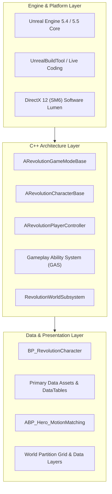

# PROJECT REVOLUTION — Architecture Overview

**Author:** Senior Technical Director  
**Target Engine:** Unreal Engine 5  
**Core Framework:** C++ Modular Architecture with Blueprint Gameplay Extensions  
**Date:** October 10, 2026  

---

## 1. High-Level Architectural Vision

Project REVOLUTION is architected as an extensible, data-driven open-world action game. To ensure that the project remains maintainable across years of iterative development, gameplay logic is strictly tiered between **High-Performance C++ Core Systems** and **Expressive Gameplay Blueprints**.

---

## 2. Core Subsystems

### 2.1 Character & Movement Architecture
- `ARevolutionCharacterBase`: Base class inheriting from `ACharacter`. Implements:
  - Integration with Unreal Engine **Enhanced Input Subsystem**.
  - Attribute sets for health, stamina, sprint, and traversal states.
  - Camera spring arm and camera management.
- `BP_RevolutionCharacter`: Blueprint child class managing cosmetic meshes, particle systems, audio hooks, and montage assignments.

### 2.2 Gameplay Ability System (GAS)
- Used for attributes, status effects, cooldowns, and combat actions.
- Player and enemies share the same base `UAbilitySystemComponent` to enable modular design.
- Attributes are driven by data tables to facilitate balancing without recompiling C++.

### 2.3 World Partitioning & Spatial Subsystems
- **One File Per Actor (OFPA):** Eliminates source control conflicts when multiple level designers or tech artists edit the same map.
- **Data Layers:** Segregates procedural vegetation, narrative triggers, encounters, and structural landmarks.
- **Subsystem Architecture:** Custom `UWorldSubsystem` classes manage ambient weather cycles, daytime illumination, and encounter spawner registries.

---

## 3. Class Hierarchy & Naming Standards

| Prefix | Class Category | Example |
| :--- | :--- | :--- |
| `A` | Actor classes | `ARevolutionCharacterBase`, `ARevolutionItemSpawner` |
| `U` | UObject / Components | `URevolutionAbilitySystemComponent`, `URevolutionInventoryComponent` |
| `F` | Structs | `FRevolutionItemData`, `FRevolutionAttributeModifier` |
| `E` | Enums | `ERevolutionCombatState`, `ERevolutionMovementStance` |
| `BP_` | Blueprint Actors | `BP_Hero_Character`, `BP_Campfire_Interactable` |
| `WBP_` | UMG Widget Blueprints | `WBP_HUD_Main`, `WBP_Inventory_Grid` |
| `SM_` | Static Meshes | `SM_Rock_Granite_01`, `SM_Castle_Wall_Modular` |
| `SK_` | Skeletal Meshes | `SK_Hero_Male`, `SK_Creature_Wyvern` |
| `M_` / `MI_` | Master Materials / Instances | `M_Master_PBR`, `MI_Rock_Granite_01` |

---

## 4. In-Game HUD & Environmental Interaction Architecture

### 4.1 Historical Aesthetic Direction
The user interface follows a **Tactile Grounded Historical Realism** design philosophy, evoking 1919-era Punjabi records, hand-printed lithographic gazettes, and brass-fitted instruments:
- **Parchment Vellum:** `FLinearColor(0.93f, 0.89f, 0.80f, 0.96f)`
- **Dark Lithographic Ink:** `FLinearColor(0.12f, 0.10f, 0.08f, 1.0f)`
- **Antique Cast Brass:** `FLinearColor(0.82f, 0.65f, 0.28f, 1.0f)`
- **Muted Sepia:** `FLinearColor(0.42f, 0.35f, 0.26f, 1.0f)`

### 4.2 Core Architecture
1. **`ARevolutionHUD` (C++):**
   - High-performance, zero-dependency Canvas rendering ensuring 100% immediate presentation across Standalone, Editor, and shipping builds.
   - **Reticle:** Grounded minimal center point transitioning dynamically to a pulsing diamond brass focus frame when an interactable prop enters line of sight.
   - **Interaction Prompt Badge:** Floating contextual `[ E ] <Action>` prompt rendered with brass key badge and shadowed text.
   - **Historical Lore Modal:** Dimmed cinematic vignette overlay with double-bordered parchment card displaying item designation, archive catalog header, wrapped historical narrative, and dismissal prompt.
   - **Dynamic Stamina Gauge:** Smoothly interpolated antique brass meter that fades in during sprint expenditure and auto-hides upon complete stamina recovery.
   - **Mohalla Orientation Compass:** Top screen cardinal ticker tracking azimuth heading (N, NE, E, SE, S, SW, W, NW).
2. **`URevolutionHUDWidget` (UMG / Slate):**
   - Base C++ UUserWidget class bridging character delegates (`OnInteractionFocusChanged`, `OnItemInspected`, `OnInspectionEnded`) to designer UMG Blueprint widgets (`WBP_RevolutionHUD`).
3. **`IInteractableInterface` & `AInspectableProp`:**
   - Decoupled interface contract enabling any world actor to respond to Kabir's camera-trace interaction queries.
   - Period props store historical provenance (`ItemName`, `LoreDescription`, `InteractionVerb`) and seamlessly trigger character lore modal state on interaction.

