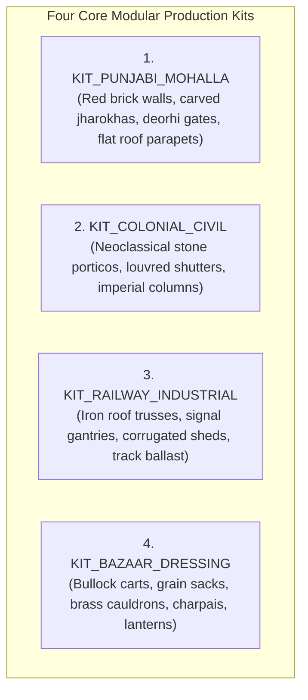
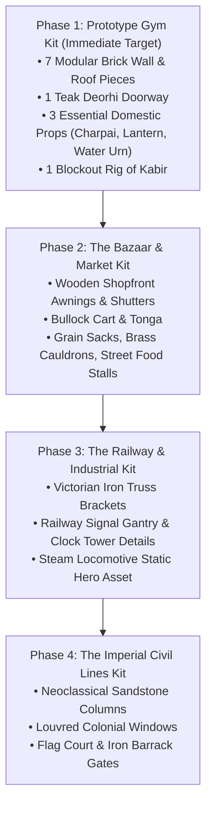

# PROJECT REVOLUTION — Asset Production Plan & Modular Modeling Guide
## Blender 5.2 to Unreal Engine 5 Production Pipeline

**Toolchain:** Blender 5.2.1 LTS $\rightarrow$ FBX 2020 $\rightarrow$ Unreal Engine 5.4 / 5.5  
**Production Strategy:** Highly Reusable Modular Kits, Master Material Instances, ORM Channel Packing  
**Author:** Lead Technical Artist & 3D Asset Lead  
**Date:** October 10, 2026  

---

## 1. Modular Kit Architecture

To achieve AAA RDR2 visual fidelity with a small development team and 4 GB VRAM limits, the entire town of Kot Gurdarshan is built from four standardized, snap-aligned modular kits:

---

## 2. Kit 1: Punjabi Native Architecture (`KIT_PUNJABI_MOHALLA`)

All modules adhere to a strict **10cm grid snap** in Blender and Unreal Engine:

| Asset ID | Mesh Name | Dimensions | Polycount Budget | LODs | Purpose |
| :--- | :--- | :---: | :---: | :---: | :--- |
| **MOD-01** | `SM_Wall_Brick_4x4m_A` | $4.0\text{m} \times 4.0\text{m} \times 0.4\text{m}$ | 1,200 tris | LOD 0–3 | Standard exterior Lahori brick wall with chipped plaster mask. |
| **MOD-02** | `SM_Wall_Brick_Doorway_4x4m` | $4.0\text{m} \times 4.0\text{m} \times 0.4\text{m}$ | 2,400 tris | LOD 0–3 | Wall section with arched opening for carved teak doorway. |
| **MOD-03** | `SM_Wall_Brick_Window_4x4m` | $4.0\text{m} \times 4.0\text{m} \times 0.4\text{m}$ | 2,100 tris | LOD 0–3 | Wall section housing an overhanging wooden *jharokha*. |
| **MOD-04** | `SM_Balcony_Jharokha_Wood_A` | $2.0\text{m} \times 1.5\text{m} \times 1.0\text{m}$ | 4,500 tris | LOD 0–2 | Intricately carved teak wooden balcony with lattice *jaali* work. |
| **MOD-05** | `SM_Door_Deorhi_Teak_01` | $1.8\text{m} \times 2.8\text{m} \times 0.1\text{m}$ | 3,200 tris | LOD 0–2 | Heavy fortified entrance gate with brass studs and iron bolt. |
| **MOD-06** | `SM_Roof_Parapet_4m_A` | $4.0\text{m} \times 1.1\text{m} \times 0.3\text{m}$ | 800 tris | LOD 0–3 | Brick rooftop parapet wall; provides physical cover for Kabir. |
| **MOD-07** | `SM_Roof_Stairs_Masonry_01` | $1.2\text{m} \times 3.0\text{m} \times 4.0\text{m}$ | 1,500 tris | LOD 0–2 | Steep masonry staircase connecting courtyard to rooftop. |

---

## 3. Kit 4: Street Dressing & Domestic Props (`KIT_BAZAAR_DRESSING`)

| Asset ID | Mesh Name | Dimensions | Polycount Budget | Texture Map | Notes |
| :--- | :--- | :---: | :---: | :---: | :--- |
| **PRP-01** | `SM_Prop_Charpai_RopeBed` | $2.0\text{m} \times 1.0\text{m} \times 0.6\text{m}$ | 2,800 tris | $1024 \times 1024$ ORM | Woven jute rope pattern on weathered wooden frame. |
| **PRP-02** | `SM_Prop_BullockCart_Wood` | $3.5\text{m} \times 1.8\text{m} \times 1.4\text{m}$ | 6,500 tris | $2048 \times 2048$ ORM | Heavy timber axle, iron-rimmed wooden spoke wheels. |
| **PRP-03** | `SM_Prop_GrainSack_Jute_01` | $0.8\text{m} \times 0.5\text{m} \times 0.3\text{m}$ | 650 tris | $1024 \times 1024$ ORM | Burlap sack stamped with imperial wheat harvest marks. |
| **PRP-04** | `SM_Prop_HurricaneLantern` | $0.2\text{m} \times 0.2\text{m} \times 0.4\text{m}$ | 1,800 tris | $1024 \times 1024$ ORM | Kerosene tin lantern with soot-blackened glass chimney. |
| **PRP-05** | `SM_Prop_Kite_Spool_Charkhi` | $0.15\text{m} \times 0.15\text{m} \times 0.3\text{m}$| 1,200 tris | $512 \times 512$ ORM | Wooden spool wrapped with glass-coated battle string (*manjha*). |
| **PRP-06** | `SM_Prop_ClayChaiCup_Kulhad` | $0.08\text{m} \times 0.08\text{m} \times 0.1\text{m}$| 250 tris | $512 \times 512$ ORM | Unglazed porous terracotta chai cup. |

---

## 4. Character Model Briefs

### Kabir (Protagonist — Act I, Age 12):
- **Height:** $1.42\text{ m}$ (4 ft 8 in)
- **Polycount Target:** 28,000 tris (LOD 0)
- **Clothing:** Loose cotton *kurta* dyed off-white with turmeric stains; lightweight cotton *pyjama* rolled up above ankles; bare feet or worn leather *mojris*; cotton shoulder satchel for school books / courier parcels.
- **Silhouette:** Lean, agile, athletic, expressive eyes, hair tied in a traditional youth topknot or soft combed side-part.

### British Mounted / Foot Police Constable:
- **Height:** $1.78\text{ m}$ (5 ft 10 in)
- **Polycount Target:** 32,000 tris (LOD 0)
- **Clothing:** Heavy khaki cotton drill tunic with brass British Crown buttons; blue/red Punjabi police turban with starched crest (*turra*); brown leather belt with brass buckle; puttees wrapped from knee to ankle; heavy leather boots.
- **Weapon / Equipment:** 5-foot polished male-bamboo *lathi* with weighted brass ferrule at the tip.

---

## 5. Phased Modeling Schedule in Blender 5.2

