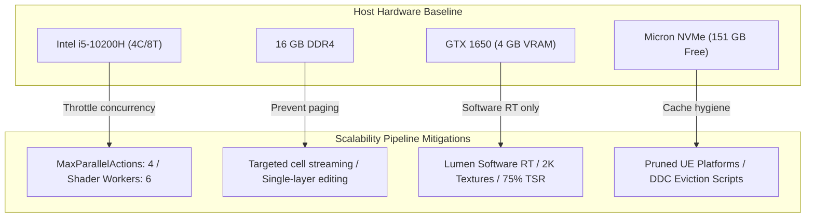

# PROJECT REVOLUTION — Hardware Capability & Scalability Specification

**Author:** Senior Technical Director  
**Evaluation Target:** Project REVOLUTION (AAA Open-World Architecture)  
**Host Profile:** Intel i5-10200H (4C/8T) | 16 GB RAM | NVIDIA GeForce GTX 1650 (4 GB VRAM) | 512 GB NVMe SSD  
**Date:** October 10, 2026  

---

## 1. Executive Hardware Capability Verdict

The development machine meets the **operational baseline** for Unreal Engine 5 development, but falls into the **constrained resource tier** for AAA open-world production. 

Rather than disabling core UE5 systems or attempting to run unconstrained high-end settings that will cause GPU crashes (`DXGI_ERROR_DEVICE_REMOVED`), the project will enforce a **Scalable Tiered Architecture**:
- Production authoring will adhere to strict memory and polygon budgets.
- Editor runtime will operate under customized, performance-friendly scalability presets.
- The pipeline preserves full capability to scale up to maximum visual fidelity on high-end hardware and final packaged builds.

---

## 2. Subsystem Capability Analysis



### 2.1 Basic Unreal Editor Usage
- **Status:** **Supported (with Scalability Profile)**
- **Baseline Behavior:** Default 'Epic' scalability at native 1080p will stress the GTX 1650 to 95–100% load with 25–35 FPS in editor.
- **Mitigation Rules:**
  - Default Editor Scalability preset: **High / Medium** (View Distance: High, Shadows: Medium, Post-Processing: Medium, Global Illumination: Medium).
  - Viewport Screen Percentage: Set to **75%** with TSR (Temporal Super Resolution) anti-aliasing.
  - Disable realtime thumbnails in Content Browser for large folders to prevent background asset rendering churn.

### 2.2 C++ Compilation & Toolchain
- **Status:** **Supported (Constrained Parallelism)**
- **Baseline Behavior:** Full C++ rebuilds without concurrency limits will saturate all 8 CPU threads and exceed 16 GB RAM during linking, causing Windows to swap to the pagefile.
- **Mitigation Rules:**
  - Cap compiler actions: `MaxParallelActions = 4` in `BuildConfiguration.xml` (already configured).
  - Rely on **Unreal Engine Live Coding** (`Ctrl + Alt + F11`) for fast incremental gameplay changes.
  - Avoid clean rebuilds unless header interfaces or build targets change.

### 2.3 Shader Compilation (`ShaderCompileWorker`)
- **Status:** **Supported (Worker Throttling Required)**
- **Baseline Behavior:** Compiling 10,000+ material permutations will lock all CPU threads at 100%, causing Windows UI unresponsiveness.
- **Mitigation Rules:**
  - Configure `BaseEngine.ini` / `DefaultEngine.ini`:
    ```ini
    [DevOptions.Shaders]
    NumUnusedShaderCompilingThreads=2
    WorkerProcessPriority=-1
    ```
  - This reserves 2 logical threads and keeps worker processes at Below-Normal priority, keeping the editor and OS fluid during compiles.

### 2.4 Nanite & Lumen Architecture
- **Status:** **Supported via Software Ray Tracing**
- **Lumen Configuration:**
  - **Hardware Ray Tracing:** **Disabled** (GTX 1650 lacks RT cores).
  - **Software Ray Tracing:** **Enabled** (Lumen uses Mesh Distance Fields and Global Distance Fields).
  - High Quality Translucency Reflections: Disabled during editor iteration.
- **Nanite Configuration:**
  - Supported for static meshes and environment assets.
  - Nanite streaming pool capped to 512 MB:
    ```ini
    r.Nanite.Streaming.PoolSize=512
    ```
- **Shadows:**
  - Virtual Shadow Maps (VSM) enabled with resolution caching or standard Cascaded Shadow Maps (CSM) for lightweight test levels.

### 2.5 Open-World Landscape & World Partition
- **Status:** **Supported via Segmented Streaming**
- **Baseline Behavior:** Loading an entire 8x8 km open world into memory at once will exceed 16 GB RAM and crash the editor.
- **Mitigation Rules:**
  - **World Partition Grid:** Enable World Partition with standard 256m or 512m cell sizing.
  - **One File Per Actor (OFPA):** Enabled by default to prevent large monolithic `.umap` files.
  - **Data Layers:** Segregate assets into distinct layers (e.g., `Terrain_Base`, `Foliage_Trees`, `POI_Settlements`, `Encounter_Spawners`). Load only active layers during specific authoring sessions.
  - **Prototyping Grid:** Initial validation test maps will use a **512m x 512m** play space before expanding outward.

### 2.6 High-Resolution Textures & Streaming Budgets
- **Status:** **Constrained Budget Enforced**
- **Baseline Behavior:** 4K textures will rapidly exceed the 4 GB VRAM ceiling and cause texture streaming thrashing.
- **Mitigation Rules:**
  - **Max Texture Size:** 2048x2048 for hero/character models; 1024x1024 or 512x512 for modular environment props.
  - **Channel Packing (ORM):** Mandate ORM textures (Red = Ambient Occlusion, Green = Roughness, Blue = Metallic). This collapses 3 grayscale maps into 1 texture sampler, saving 66% VRAM and 2 texture fetch cycles.
  - **Texture Streaming Pool:** Capped at 1800 MB:
    ```ini
    r.Streaming.PoolSize=1800
    ```

### 2.7 Blender Modeling & Asset Pipeline
- **Status:** **Fully Supported**
- **Capabilities:**
  - Low/Mid-poly asset creation, retopology, UV unwrapping, and rigging in Blender 5.2.
  - Normal map and AO baking via Cycles GPU compute (CUDA 7.5 on GTX 1650).
  - Polycount targets: Characters $\le 35,000$ tris; Modular props $\le 10,000$ tris; Nanite props $\le 200,000$ tris.

### 2.8 Packaging & Performance Profiling
- **Status:** **Fully Supported**
- **Execution:**
  - Shipping/Development builds will be packaged with Win64 target.
  - Performance profiling will use Unreal Insights (`-trace=default,gpu,cpu,memory`) and in-engine statistics (`stat unit`, `stat fps`, `stat rhi`, `profilegpu`).
  - Cooking times will benefit from NVMe SSD throughput.

---

## 3. Pre-Engine Scalability Configuration Template

Below is the validated `DefaultScalability.ini` template that will be injected into the Unreal project configuration in Phase 7:

```ini
[ScalabilitySettings]
PerfIndexThresholds_Editor="GPU 18.0 28.0 38.0"

[ShadowQuality@1]
r.ShadowQuality=2
r.Shadow.Virtual.Cache.MaxPageAge=32

[GlobalIlluminationQuality@1]
r.Lumen.DiffuseIndirect.Allow=1
r.Lumen.Reflections.Allow=1
r.Lumen.HardwareRayTracing=0
r.Lumen.ScreenProbeGather.DownsampleFactor=16

[PostProcessQuality@1]
r.ScreenPercentage=75
r.TemporalAA.Upscaling=1
```

---

## 4. Hardware Scalability Summary Checklist

- [x] RAM limit verified and concurrency constrained.
- [x] GTX 1650 VRAM budget established (1800 MB streaming pool).
- [x] Software Ray Tracing locked as Lumen baseline.
- [x] 2K texture maximum and ORM channel packing mandated.
- [x] World Partition cell streaming strategy defined.
- [x] Scalability configuration template prepared.
