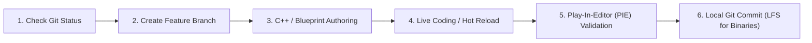

# PROJECT REVOLUTION — Development Workflow & Engineering Standards

**Author:** Senior Technical Director  
**Audience:** Developers, Technical Artists, Systems Programmers  
**Date:** October 10, 2026  

---

## 1. Daily Development Loop

1. **Morning Inspection:**
   - Run `Tools/check_disk_space.ps1` to ensure NVMe storage headroom ($\ge 25\text{ GB}$).
   - Run `git status` to verify working tree cleanliness.
2. **C++ Development:**
   - Launch Visual Studio 2022 via solution generated by `generate_unreal_project.ps1`.
   - Implement gameplay interfaces or subsystem logic.
   - Use **Live Coding** (`Ctrl + Alt + F11`) in Unreal Editor for quick compilation.
3. **Blueprint & Content Iteration:**
   - Create blueprints extending C++ base classes.
   - Test mechanics directly in the test map `L_Validation_Gym`.
4. **Committing Changes:**
   - Review untracked files with `git status`.
   - Never commit generated folders (`Intermediate`, `Saved`, `DerivedDataCache`).

---

## 2. Coding Standards & Best Practices

1. **Header Hygiene:**
   - Minimize `#include` statements in header files; prefer forward declarations (`class ARevolutionCharacterBase;`).
   - Group headers: Standard library, Unreal Engine modules, Project headers.
2. **Memory Safety:**
   - Use `UPROPERTY()` on all UObject pointers to enable garbage collection tracking and prevent dangling pointers.
   - Use `TWeakObjectPtr<>` for non-owning references.
3. **Tick Optimization:**
   - Disable actor ticking (`PrimaryActorTick.bCanEverTick = false`) unless continuous per-frame calculation is strictly unavoidable.
   - Use timers (`FTimerManager`) and event-driven delegates instead of polling in `Tick()`.
4. **Blueprint Guidelines:**
   - Keep event graphs clean; break complex graphs into private functions and collapsed graphs.
   - Blueprints should handle cosmetic responses, sound effects, particle triggers, and presentation. Core math and system coordination belong in C++.
