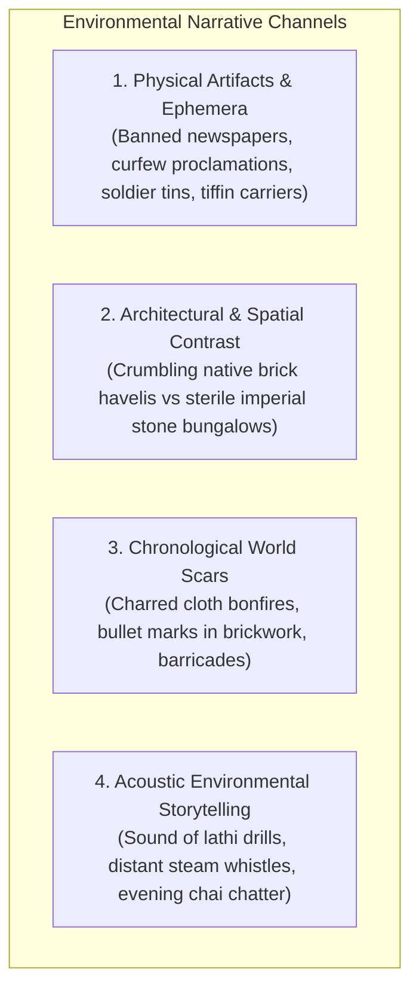
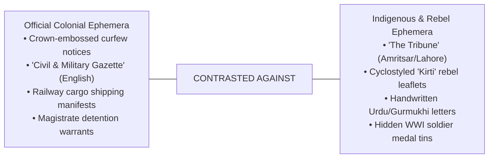

# PROJECT REVOLUTION — Environmental Storytelling & Narrative Artifacts

**Setting:** Kot Gurdarshan, Central Punjab (1919 – 1929)  
**Inspiration:** *Red Dead Redemption 2*, *Sardar Udham*, *Chernobyl* (Visual Storytelling)  
**Philosophy:** Silent, Tactile World Building (Show, Never Over-Explain)  
**Author:** Lead Narrative Designer & Environment Artist  
**Date:** October 10, 2026  

---

## 1. Environmental Storytelling Framework

In **REVOLUTION**, narrative is not delivered through giant expository dialogue dumps or floating floating UI objective markers. The world itself speaks through:

---

## 2. In-Game Documents & Physical Ephemera

### 1. The Dual Newspapers:
- **The Official Press:** *The Civil and Military Gazette* (Lahore). Neatly printed on fine newsprint. Found on the veranda of the European Club and the Deputy Commissioner's office. Headlines minimize Indian unrest, praise imperial railway efficiency, and dismiss protests as "misguided agitators manipulated by foreign bolsheviks."
- **The Vernacular & Nationalist Press:** *The Tribune* and underground cyclostyled newsletters like *Kirti* (The Worker) and *Bande Mataram*. Printed on coarse, fibrous paper with ink smudges. Smuggled inside rolls of dyed cotton cloth and folded into student notebooks. Contains uncensored reports of police brutality and martyrdom.

### 2. The Wall Proclamations:
- White proclamation sheets bearing the Royal Coat of Arms of the United Kingdom, pasted with flour glue onto ancient brick walls and temple gateways:
  - *Order Under Section 144 CrPC (April 1919):* Banning the assembly of more than four persons in public thoroughfares.
  - *Notice of Curfew & Disconnection of Municipal Water (Martial Law 1919):* Penalizing neighborhoods suspected of cutting telegraph lines.
  - *Reward Notices (1928):* Offering 500 Rupees for information leading to the capture of underground student courier networks.

### 3. Domestic Story Objects:
- **Uncle Baldev's Tin Box:** An old British Army biscuit tin concealed beneath a floorboard in the storeroom. Contains his 1914–15 Star medal, a shrapnel fragment extracted from his shoulder at Kut-al-Amara, a faded sepia postcard from a hospital in Brighton, and an imperial discharge certificate noting a monthly pension of three rupees.
- **Master Ramlal's Brass Measure:** An English wooden yardstick stamped with the royal crown, alongside a traditional Indian brass finger-measure (*ungul*). Represents the clash between traditional craftsmanship and standardized imperial taxation.

---

## 3. Spaces That Evolve with the Story (Chronological Scars)

### The Town Square (Mandi Chowk):
- **Act I (1919):** An innocent, dusty commercial center. Bullock carts unloading grain; children playing hopscotch on paving stones.
- **Act II (1920):** Center of the Non-Cooperation movement. A mountain of imported Lancashire cloth is set ablaze. For weeks afterward, charred black ash clings to the cobblestones; local shopkeepers defiantly hang handspun khadi shawls from their verandas.
- **Act IV (1928):** Heavy barbed-wire barricades and sandbagged police checkpoints divide the square. Mounted imperial constables patrol the perimeters. The cobblestones are stained with dried red dye from a broken holi cart—or blood from a recent lathi charge.

---

## 4. Audio Environmental Storytelling

The acoustic environment is treated with the same depth as a Roger Deakins film score:

1. **Domestic Warmth:**
   - Soft bubbling of lentils (*dal*) in a brass handi.
   - Rhythmic clatter of Kabir's father's pedal-driven sewing machine.
   - Pigeons cooing gently under wooden balcony eaves.
2. **Industrial Oppression:**
   - The distant, rhythmic *chug-chug* of the North Western Railway freight engine hauling Indian cotton away to Karachi port.
   - Heavy iron clang of locomotive buffers in the marshaling yard.
3. **Colonial Tension:**
   - The synchronized thud of hobnailed British infantry boots on brick pavement.
   - The sharp, metallic crack of a brass-tipped bamboo lathi struck against a stone threshold to intimidate civilians into clearing the street.
   - The wailing steam whistle of the railway clock tower signaling the onset of night curfew.
