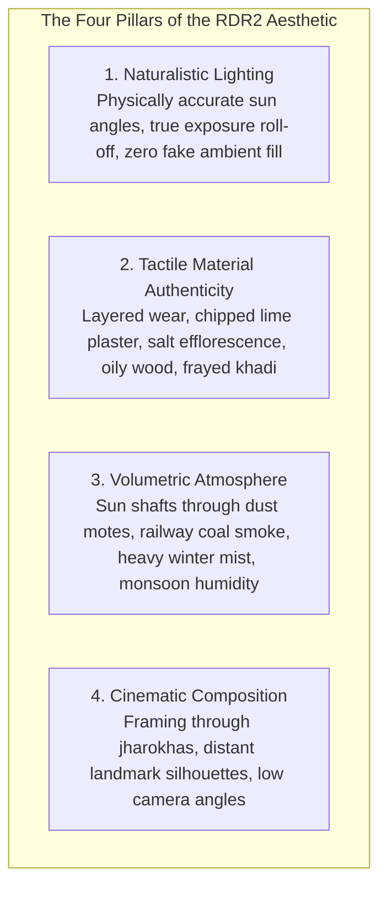
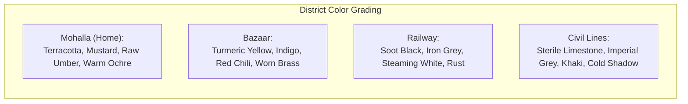
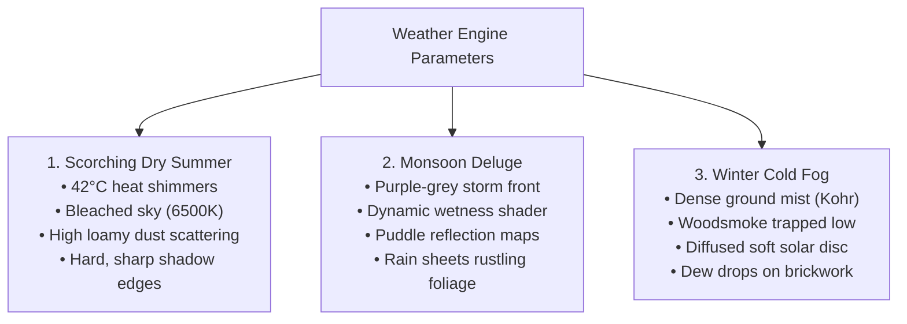
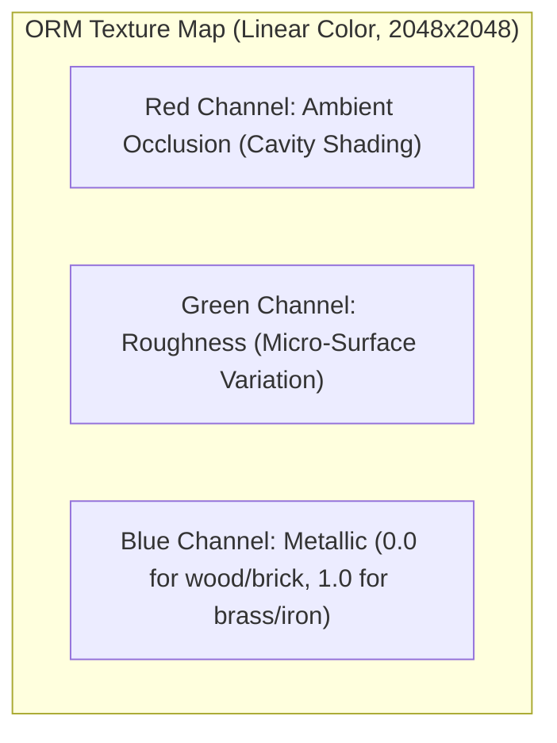
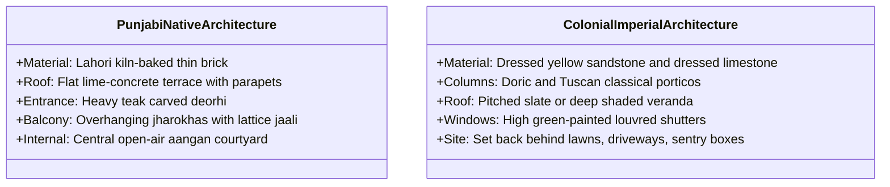

# PROJECT REVOLUTION — Environment Art Bible & Visual Direction
## The "Red Dead Redemption 2" Aesthetic in 1920s Colonial Punjab

**Visual Target:** Grounded, Tactile, Cinematic Historical Realism (RDR2 Quality Baseline)  
**Cinematic Influences:** *Red Dead Redemption 2*, *Sardar Udham* (Dir. Shoojit Sircar), *Pather Panchali* (Dir. Satyajit Ray)  
**Engine & Shading:** Unreal Engine 5 (Lumen Software Ray Tracing, TSR, ORM PBR Pipeline)  
**Hardware Target:** Optimized for NVIDIA GTX 1650 (4 GB VRAM) & 16 GB RAM  
**Author:** Environment Art Director & Technical Artist  
**Date:** October 10, 2026  

---

## 1. Core Visual Pillars



### Pillar 1: Naturalistic, Unforgiving Lighting
- **No Video-Game "Candy Colors":** Avoid artificial hyper-saturation and unrealistic neon accents. Sunlight adheres to realistic Kelvin temperatures (2500K at dawn/dusk to 6000K at solar noon).
- **True Physical Exposure:** Stepping from a blinding, sun-drenched bazaar into a shadowy brick courtyard triggers realistic camera iris eye-adaptation. Interior shadows are rich and deep, illuminated solely by soft ambient bounce and warm kerosene lamps.
- **Nighttime Reality:** Night is truly dark. No artificial cyan ambient skylight. Streets are lit exclusively by flickering mustard-oil clay lamps (*diyas*), hurricane kerosene lanterns, and distant railway gas lamps.

### Pillar 2: Tactile Material Authenticity & Weathering
- **The "Lived-In" Rule:** Nothing in Kot Gurdarshan looks freshly minted. Every surface shows decades of human contact, wind, monsoons, and dust.
- **Layered Shading:** Walls are not a single texture. They feature:
  - Base: Porous kiln-baked red Lahori brick.
  - Layer 1: Chipped, peeling lime-surkhi plaster (*choona*).
  - Layer 2: White salt efflorescence (*shora*) creeping up from damp foundations.
  - Layer 3: Dirt accumulation, soot smudges from evening oil lamps, and hand-rubbed wear near door handles.

### Pillar 3: Atmospheric Depth & Volumetric Air
- **Air You Can Taste:** In RDR2, air is a physical volume. In Kot Gurdarshan, the air carries loamy alluvial dust, cow-dung smoke, roasting cumin, coal soot, and monsoon moisture.
- **Volumetric Light Shafts (*Crepuscular Rays*):** Sunlight slices through slatted wooden shutters, breaks through dense foliage of banyan trees, and pierces the dusty gloom of the locomotive shed.

### Pillar 4: Cinematic Framing & Grounded Camera
- **The Child's Perspective:** Camera position is set slightly lower than typical adult third-person games (chest height of a 12-year-old in Act I), making townhouses, station arches, and British mounted police feel towering, imposing, and authentic.

---

## 2. Color Palettes by District & Narrative Stage



| District / Zone | Primary Palette | Key Accent Colors | Mood & Lighting Intent |
| :--- | :--- | :--- | :--- |
| **Mohalla Darzian (Home)** | Terracotta Red, Raw Umber, Warm Cream, Mud Ochre | Brass gold, indigo fabric scraps, green tulsi leaf | Safe, protective, familial warmth, golden hour domestic peace. |
| **Grand Bazaar & Mandi** | Turmeric Yellow, Terracotta, Dust Khaki, Burlap Tan | Dried red chili, raw copper, cobalt blue glass bangles | Vibrant sensory overload, commercial hustle, midday heat haze. |
| **Railway Junction** | Soot Black, Cast-Iron Grey, Ballast Stone, Greasy Slate | Rusted iron oxide, red/green signal glass, locomotive firebox glow | Gritty, deafening, industrial subjugation, steam plumes. |
| **Civil Lines & Cantonment** | Imperial Off-White, Manicured Lawn Green, Sandstone Ochre | Union Jack red, polished British brass, khaki uniform drab | Sterile, arrogant, intimidating, cold shade under deep verandas. |
| **Agrarian Countryside** | Golden Mustard (*Sarson*), Wheat Amber, Loamy Silt Brown | Canal water silt grey, kiln chimney brick red | Expansive, seasonal, humble, wind-swept alluvial horizon. |

---

## 3. Dynamic Weather & Seasonal Atmosphere States



### 1. Scorching Dry Summer (April – June)
- **Visual Feel:** Unforgiving, glaring heat.
- **Shading Details:** Surface textures desaturated by blinding sunlight; heat-distortion post-process shimmering over railway tracks and brick kilns; loose loamy dust kicking up from footsteps and cart wheels.

### 2. The Monsoon Tempest (July – September)
- **Visual Feel:** Dramatic, violent, transformative, tactile.
- **Shading Details:** 
  - Dynamic **Wetness Roughness Multiplier** driven by Material Parameter Collection (`MPC_Weather.Wetness`).
  - Brickwork deepens in tone by 40% when wet.
  - Clay paths churn into thick, reflective mud. Water streams off tin bazaar roofs and gurgles down open stone drainage gullies.

### 3. Winter Cold Fog (*Kohr*) (December – February)
- **Visual Feel:** Melancholy, quiet, cinematic, tense.
- **Shading Details:** 
  - Thick morning radiation fog clinging to the soil and mustard fields.
  - Peepal trees emerging as dark silhouettes out of white mist.
  - Woodsmoke and cow-dung smoke trapped low to the ground by temperature inversions, creating heavy volumetric light rays.

---

## 4. Material Specifications & Texture Budget (GTX 1650 4 GB VRAM)

To achieve RDR2 visual fidelity without exceeding 4 GB VRAM, the material pipeline enforces **Channel Packing**, **Macro/Micro Detail Normal Blending**, and **Master Material Instancing**:



### 1. Brickwork Material (`M_Master_LahoriBrick`):
- **Base Color:** Baked alluvial clay red with subtle tonal variation between individual bricks.
- **Normal Map:** Hand-chiseled brick edges and porous surface crevices.
- **Detail Normal:** Tiled high-frequency micro-grain sand texture (scales seamlessly up close).
- **Vertex Painting Channels:**
  - Red Channel: Chipped lime plaster overlay (*choona*).
  - Green Channel: Dampness / Moss staining in bottom 50cm.
  - Blue Channel: White salt efflorescence (*shora*).

### 2. Wood Material (`M_Master_TeakWood`):
- **Base Color:** Deep brown aged Indian teak (*sagwan*).
- **Roughness Map:** Low roughness (smooth/shiny) on handrails and door handles from human hand oils; high roughness (rough/matte) on sun-exposed window frames.

### 3. Mud & Soil Material (`M_Master_AlluvialSoil`):
- **Blend Layers:** Dry dusty silt $\rightarrow$ Churned footprint mud $\rightarrow$ Standing puddle water.
- **Puddle Mask:** Screen-space planar reflections with subtle ripple normal animation.

---

## 5. Architectural Language: Native vs Colonial



---

## 6. Lighting & Shading Setup in Unreal Engine 5

- **Dynamic Global Illumination:** `Lumen Software Ray Tracing` (Distance Fields enabled).
- **Directional Light:** Casts Virtual Shadow Maps with optimized cache (`r.Shadow.Virtual.Cache.MaxPageAge 32`).
- **Skylight:** Real-time capture with distance field ambient occlusion.
- **Volumetric Fog:** Grid pixel size set to 16 for smooth volumetric beams without GPU frame drops:
  ```ini
  r.VolumetricFog=1
  r.VolumetricFog.GridPixelSize=16
  r.VolumetricFog.HistoryMissSupersampleCount=4
  ```
- **Post-Process Volume:** Filmic ACES tonemapper, subtle chromatic aberration at screen edges (0.1), organic film grain (0.15) to simulate period celluloid film stock.
