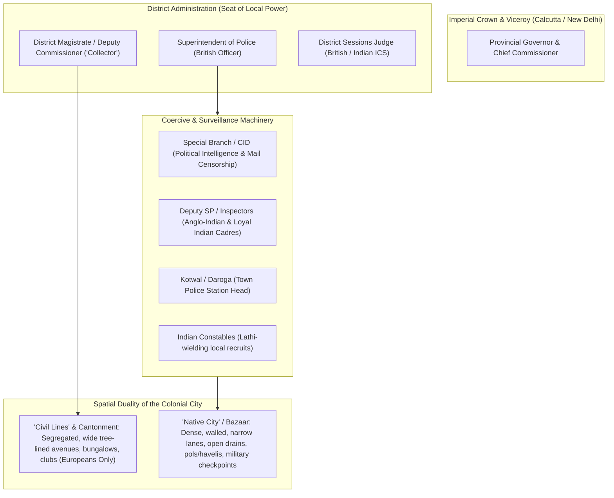
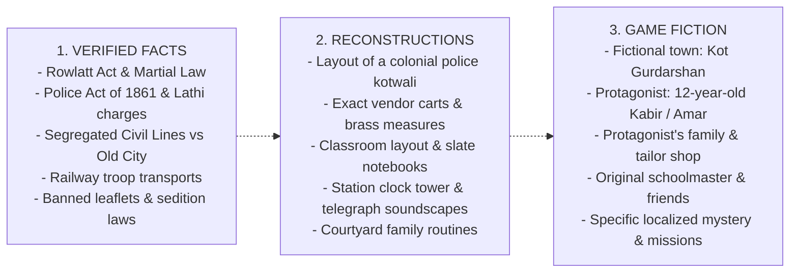

# PROJECT REVOLUTION — Historical Research & Setting Analysis

**Classification:** Historical Grounding, Archival Research & Setting Dossier  
**Author:** AAA Open-World Historical Researcher & Creative Director  
**Engine Baseline:** Unreal Engine 5 (Target: Project REVOLUTION)  
**Date:** October 10, 2026  

---

## 1. Research Methodology & Epistemological Framework

To create an authentic, emotionally devastating, and respectful open-world experience of British-ruled India during the freedom struggle, the project strictly delineates three categories of material:

1. **Verified Historical Facts (Tier 1 - Documented):**  
   Primary legislation (Rowlatt Act 1919, Defence of India Acts, Vernacular Press Act), administrative records of the British Raj (Imperial Gazetteers of India, Indian Police Commission Reports 1902–03), documented economic tariffs, railway timetables, court structures, land revenue (*lagaan* / *ryotwari* / *zamindari*), and authenticated historical events (Jallianwala Bagh, Non-Cooperation, Salt Satyagraha, Kakori, Chittagong).
2. **Reasonable Historical Reconstructions (Tier 2 - Architectural & Material Culture):**  
   Everyday material life reconstructed from museum archives (National Museum New Delhi, Victoria and Albert Museum colonial collections, Alkazi Collection of Photography, British Library India Office Records). This includes bazaar vendor inventories, colonial school curricula, domestic kitchen utensils, fabric dyes (indigo, khadi, madder), railway signaling apparatus, and municipal gas/oil lamp posts.
3. **Fictional Elements Created for Project REVOLUTION (Tier 3 - Narrative Design):**  
   The protagonist, his family, friends, mentors, specific street names, local merchants, fictional magistrate and police superintendent, personal diaries, and immediate story encounters.

> [!IMPORTANT]
> Historical evidence is never falsified or invented. Real historical figures (e.g., Lala Lajpat Rai, Bhagat Singh, Mahatma Gandhi, Subhas Chandra Bose) exist in the world as real historical forces referenced through speeches, banned newspapers, whispers, and distant public rallies, but they are not reduced to video-game quest givers or caricatures.

---

## 2. Institutional Analysis of the British Raj

### 2.1 The Administrative Machinery
- **The "Collector" (District Magistrate):** The absolute sovereign of the district. Held executive, fiscal, and magisterial power. He determined land revenue assessments, signed detention warrants, and commanded police deployments.
- **The Police System:** Governed by the Police Act of 1861 (passed directly after the 1857 rebellion to ensure a coercive, militarized civil police rather than a community service). Constables carried 5-foot bamboo *lathis* tipped with brass; armed reserves carried .303 Lee-Enfield or older Martini-Henry/Enfield smoothbore carbines.
- **The Special Branch (CID):** Operated extensive surveillance networks. Postal censorship (opening letters of suspected families), interception of printed pamphlets, monitoring of train passenger manifests, and photographing of political suspects.

### 2.2 Economic Exploitation & Fiscal Realities
- **Land Revenue Extraction:** In ryotwari and zamindari zones, revenue had to be paid in cash regardless of drought, flood, or harvest failure. Default led to immediate confiscation of ancestral land, bullocks, or cooking brass.
- **De-industrialization & Tariffs:** British manufactured goods (Lancashire cotton, Sheffield steel) entered India with near-zero tariffs, while Indian handlooms and artisans were taxed. The bazaar reflects this stark contrast: cheap imported foreign cloth (*videshi kapda*) stacked against struggling local weavers' wares.
- **Salt & Forest Monopolies:** Colonial law criminalized the natural collection of sea/rock salt and barred villagers from collecting fallen timber, fodder, or honey from ancestral forests without colonial forestry permits.

---

## 3. Daily Material Life & Childhood in Colonial India

### 3.1 Domestic Life of an Ordinary Family
- **Home Layout:** Central open-sky courtyard (*aangan*), verandas with wooden colonnades, flat mud/brick roof terraces accessed by narrow masonry stairs, storerooms with large terracotta grain urns (*kothi*).
- **Daily Rhythms:** Dawn prayers, cleaning of verandas with cow-dung wash or lime, fetching water from public or community wells, brass tiffin carriers packed for school, evening street lamps lit with mustard or kerosene oil, family gatherings on rooftops under summer skies.
- **Diet:** Coarse grains (bajra, jowar, wheat roti), spiced lentils (dal), seasonal vegetables (mustard greens/sarson, gourds), fresh butter, jaggery (*gur*), clay-pot tea (*kulhad chai*).

### 3.2 The Colonial School Experience
- **Curriculum & Ideology:** Macaulay's educational legacy—instruction aimed at producing loyal clerical clerks (*babus*). British imperial maps hanging on whitewashed walls, portraits of King George V, recitation of British royal anthems alongside Victorian geography and arithmetic.
- **The Counter-Culture:** Secret exchange of nationalist poetry (Rabindranath Tagore, Muhammad Iqbal, Bismil), banned magazines (*Kirti*, *Bande Mataram*, *Prabhat*), passionate political debates in school alleys and athletic wrestling grounds (*akharas*).

---

## 4. Archival Research Register & Sources

| Category | Primary Historical Source / Archive | Key Findings Relevant to REVOLUTION | Historical Confidence |
| :--- | :--- | :--- | :--- |
| **Colonial Governance** | *Imperial Gazetteer of India* (Vols. I–XXVI, Oxford University Press, 1908–1931) | Exact district population statistics, police station staffing, railway line gauges, and trade commodities. | **Tier 1 (Verified Fact)** |
| **Martial Law & Surveillance** | *Report of the Commissioners Appointed by the Punjab Sub-Committee of the Indian National Congress* (1920) | Eyewitness testimonies of 1919 Punjab martial law: curfew regulations, crawling orders, public flogging squares, water and electricity cuts to native quarters. | **Tier 1 (Verified Fact)** |
| **Police & Prisons** | *Report of the Indian Police Commission 1902–03*; *Indian Jail Committee Report 1919–20* | Uniform details (khaki jackets, turbans, lathis), lockup dimensions, interrogation logs, solitary confinement rules. | **Tier 1 (Verified Fact)** |
| **Material Culture & Photography** | *The Alkazi Collection of Photography* & *British Library India Office Records (Photo 1000)* | Authentic visual evidence of 1910s–1930s Indian streetscapes, bullock cart axle designs, vendor displays, railway platforms, school desks, and signage fonts. | **Tier 2 (Reasonable Reconstruction)** |
| **Revolutionary Networks** | *Sedition Committee Report 1918* (Rowlatt Committee); Memoirs of Manmath Nath Gupta, Bhagat Singh (*Why I Am An Atheist*, 1930) | Structure of underground student cells: courier networks, cyphers, cyclostyle duplicators for pamphlets, arms transport via tiffin tins. | **Tier 1 (Verified Fact)** |
| **Economic Conditions** | R.C. Dutt, *The Economic History of India under Early British Rule* (1902); Dadabhai Naoroji, *Poverty and Un-British Rule in India* (1901) | Exact tariff structures, drainage of wealth calculations, grain price fluctuations during famine years. | **Tier 1 (Verified Fact)** |

---

## 5. Separation Matrix: Fact vs Reconstruction vs Fiction

