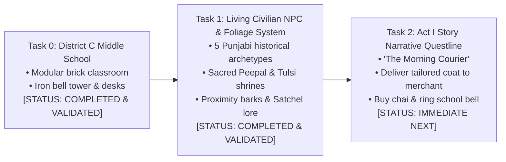

# PROJECT REVOLUTION — Next Development Steps
## Concrete Tasks & Dependency Roadmap for Phase 4 & Phase 5

**Classification:** Immediate Development Action Plan  
**Target Horizon:** Next 3 Milestones  
**Date:** October 12, 2026  

---

## 1. Top Concrete Development Tasks

---

### Task 0: Construct District C — The Vernacular Middle School [COMPLETED]
- **Status:** **100% COMPLETE & VALIDATED IN-ENGINE**
- **Implemented Components:**
  - Gateway Archway & bilingual Vernacular School plaque (`SM_School_Signboard`).
  - Schoolyard Central Iron Bell Tower (`SM_School_Bell_Tower_Iron`) at $(1350, 1350, 0)$.
  - Classroom 4B Brick Compound with entrance doorway, arched windows, and solid walkable roof slabs at $Z = 400\text{ cm}$.
  - Classroom Interior: Dual student desk benches (`SM_School_Desk_Bench_Wood`), timber-framed slate blackboard (`SM_School_Blackboard_Easel`), and evening literacy lantern.
  - Family Workshop: Singer sewing machine (`SM_Prop_SewingMachine_Singer`), tailor charpai, and chai kulhad at $(200, 520, 0)$.

---

### Task 1: Living Civilian NPC & Foliage System [COMPLETED]
- **Status:** **100% COMPLETE & VALIDATED IN-ENGINE**
- **Implemented Components:**
  - Dedicated C++ class `ACivilianNPCActor` implementing `IInteractableInterface`.
  - 5 authentic historical archetypes with unique lore, perspectives, and visual accessories:
    1. *Ram Lubhaya (Master Tailor / Kabir's Father):* Working Singer sewing machine on family veranda $(200, 480, 88)$.
    2. *Ghasita Bhishti (Traditional Water-Carrier):* Carrying leather goatskin *mashk* by the communal well $(-80, 1320, 88)$.
    3. *Hira Halwai (Tea Stall Owner):* Serving steaming cardamom chai kulhads at the Grand Bazaar stall $(-200, 1680, 88)$.
    4. *Lala Karam Chand (Cloth Merchant):* Managing Manchester & Swadeshi khadi bolts at the mandi stall $(200, 1980, 88)$.
    5. *Pandit Kashi Ram (School Headmaster):* Teaching and overseeing the schoolyard iron bell tower $(1350, 1420, 88)$.
  - Historical Foliage & Nature:
    - *Sacred Peepal Tree with Chabutra Shrine* (`SM_Foliage_PeepalTree_Shrine`) at $(380, 1350, 0)$ in Zone C.
    - *Courtyard Sacred Tulsi Planter Pedestal* (`SM_Prop_Tulsi_Pedestal`) at $(120, 80, 0)$ in Zone A.
  - Natural player tracking (smooth head/torso turn toward Kabir within 2.8m).
  - Ambient proximity barks and multi-line interactive dialogues displayed via Kabir's inspection modal.

---

### Task 2: Implement Act I Exploratory Quest — "The Morning Courier"
- **Objective:** Create the first playable story mission validating the entire journey from home to market to school.
- **Mission Flow:**
  1. Kabir wakes in the family courtyard; father Ram Lubhaya asks him to deliver the repaired khadi coat to Lala Karam Chand in the Grand Bazaar.
  2. Kabir climbs the stairs to the rooftop to check on his Basant fighter kite.
  3. Kabir vaults the roof parapet or descends through the Deorhi gateway, greets Ghasita Bhishti at the communal well, and enters the bazaar.
  4. Delivers the coat to Lala Karam Chand, receives payment, and stops at Hira Halwai's stall for hot chai.
  5. Inspects the new colonial proclamation posted on the municipal board and hears the curfew warning.
  6. Arrives at the Vernacular Middle School and rings the central iron bell tower to call morning classes.
- **Dependencies:**
  - `ObjectiveTriggerActor.cpp` and `RevolutionMissionSubsystem.cpp`.
