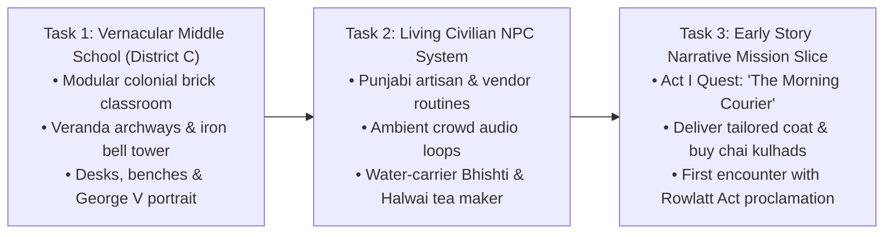

# PROJECT REVOLUTION — Next Development Steps
## Concrete Tasks & Dependency Roadmap for Phase 4

**Classification:** Immediate Development Action Plan  
**Target Horizon:** Next 3 Milestones  
**Date:** October 11, 2026  

---

## 1. Top 3 Concrete Development Tasks

---

### Task 1: Construct District C — The Vernacular Middle School
- **Objective:** Build the third key district of Kot Gurdarshan representing Kabir's school life in April 1919.
- **Components:**
  - Single-story colonial brick compound with high arched lime-washed verandas.
  - Classroom 4B interior: wooden benches with inkwells, slate blackboards, King George V imperial portrait.
  - Schoolyard courtyard with dust cricket pitch and central iron bell tower.
- **Dependencies:**
  - Reuse modular brick wall kit (`SM_Wall_Brick_4x4m_A`, `SM_Floor_Ceiling_Slab_4x4m`).
  - Create classroom bench and school bell tower assets in Blender.

---

### Task 2: Implement Ambient Civilian NPCs & Daily Life Routines
- **Objective:** Populate Mohalla Darzian and Grand Bazaar with a small number of believable, historically grounded Punjabi townspeople.
- **Components:**
  - 4 foundational NPC archetypes:
    1. *The Halwai Tea Maker:* Boiling chai and pouring into clay kulhads at the Zone D stall.
    2. *The Water-Carrier (Bhishti):* Carrying leather goatskin water bag (*mashk*) near the communal well.
    3. *Kabir's Father (Darzi):* Working the foot-pedal sewing machine on the family veranda.
    4. *The Cloth Merchant:* Arguing prices over stacks of Manchester cotton.
  - Idle animation state machines and historical Urdu/Punjabi voice bark triggers.
- **Dependencies:**
  - Skeletal mesh mannequin rig binding.
  - Dialogue subsystem and NPC interaction trigger volumes.

---

### Task 3: Implement Act I Exploratory Quest — "The Morning Courier"
- **Objective:** Create the first playable story mission validating the entire journey from home to market.
- **Mission Flow:**
  1. Kabir wakes in the family courtyard; father asks him to take a repaired coat to the cloth merchant in the Grand Bazaar.
  2. Kabir climbs the stairs to the rooftop to check on his Basant fighter kite.
  3. Kabir vaults the roof parapet or descends to the Deorhi gateway, walks past the communal well, and enters the bazaar.
  4. Delivers the coat, overhears rumors about curfew sirens at the tea stall, and inspects the new colonial proclamation posted on the municipal board.
- **Dependencies:**
  - Tasks 1 & 2.
  - Quest objective triggers (`ObjectiveTriggerActor.cpp`).
