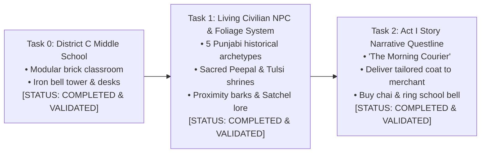
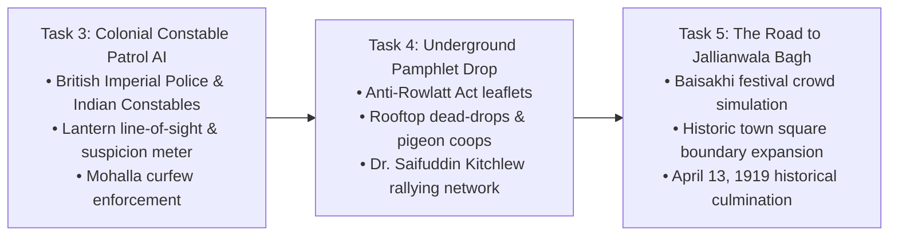

# PROJECT REVOLUTION — Next Development Steps
## Concrete Tasks & Dependency Roadmap for Phase 4 & Phase 5

**Classification:** Immediate Development Action Plan  
**Target Horizon:** Next 3 Milestones  
**Date:** October 12, 2026  

---

## 1. Top Concrete Development Tasks

---

### Task 0: Construct District C — The Vernacular Middle School [COMPLETED]
- **Status:** **100% COMPLETE & VALIDATED IN-ENGINE**
- **Implemented Components:**
  - Gateway Archway & bilingual Vernacular School plaque (`SM_School_Signboard`).
  - Schoolyard Central Iron Bell Tower (`SM_School_Bell_Tower_Iron`) at $(1350, 1350, 0)$.
  - Classroom 4B Brick Compound with entrance doorway, arched windows, and solid walkable roof slabs at $Z = 400\text{ cm}$.
  - Classroom Interior: Dual student desk benches (`SM_School_Desk_Bench_Wood`), timber-framed slate blackboard (`SM_School_Blackboard_Easel`), and evening literacy lantern.
  - Family Workshop: Singer sewing machine (`SM_Prop_SewingMachine_Singer`), tailor charpai, and chai kulhad at $(200, 520, 0)$.

---

### Task 1: Living Civilian NPC & Foliage System [COMPLETED]
- **Status:** **100% COMPLETE & VALIDATED IN-ENGINE**
- **Implemented Components:**
  - Dedicated C++ class `ACivilianNPCActor` implementing `IInteractableInterface`.
  - 5 authentic historical archetypes with unique lore, perspectives, and visual accessories:
    1. *Ram Lubhaya (Master Tailor / Kabir's Father):* Working Singer sewing machine on family veranda $(200, 480, 88)$.
    2. *Ghasita Bhishti (Traditional Water-Carrier):* Carrying leather goatskin *mashk* by the communal well $(-80, 1320, 88)$.
    3. *Hira Halwai (Tea Stall Owner):* Serving steaming cardamom chai kulhads at the Grand Bazaar stall $(-200, 1680, 88)$.
    4. *Lala Karam Chand (Cloth Merchant):* Managing Manchester & Swadeshi khadi bolts at the mandi stall $(200, 1980, 88)$.
    5. *Pandit Kashi Ram (School Headmaster):* Teaching and overseeing the schoolyard iron bell tower $(1350, 1420, 88)$.
  - Historical Foliage & Nature:
    - *Sacred Peepal Tree with Chabutra Shrine* (`SM_Foliage_PeepalTree_Shrine`) at $(380, 1350, 0)$ in Zone C.
    - *Courtyard Sacred Tulsi Planter Pedestal* (`SM_Prop_Tulsi_Pedestal`) at $(120, 80, 0)$ in Zone A.
  - Natural player tracking (smooth head/torso turn toward Kabir within 2.8m).
  - Ambient proximity barks and multi-line interactive dialogues displayed via Kabir's inspection modal.

---

### Task 2: Implement Act I Exploratory Quest — "The Morning Courier" [COMPLETED]
- **Status:** **100% COMPLETE & VALIDATED IN-ENGINE**
- **Implemented Components:**
  - Expanded `RevolutionMissionSubsystem` with full 8-stage Act I narrative loop:
    1. `Stage_Morning_FatherTailor`: Converse with master tailor Ram Lubhaya on the veranda.
    2. `Stage_Morning_RooftopKite`: Climb courtyard stairs, inspect Basant fighter kite, and survey mohalla rooftops.
    3. `Stage_Morning_WellBhishti`: Descend through Deorhi gateway, meet Ghasita Bhishti at communal well square.
    4. `Stage_Morning_DeliverCloth`: Enter Grand Bazaar, hand over tailored khadi coat to Lala Karam Chand.
    5. `Stage_Morning_ChaiHalwai`: Drink hot cardamom chai kulhad at Hira Halwai's stall; hear Rowlatt Act unrest rumors.
    6. `Stage_Morning_ProclamationBoard`: Inspect/deface Section 144 martial law curfew order on proclamation board.
    7. `Stage_Morning_SchoolBell`: Enter Vernacular Middle School courtyard and toll central wrought-iron bell (`SFX_Dawn_Temple_Bell`).
    8. `Stage_Morning_ClassroomDesk`: Take assigned pupil desk in Classroom 4B; complete Act I prologue (`SFX_Dawn_Gong_Complete`).
  - Integrated audio feedback triggers (`UGameplayStatics::PlaySoundAtLocation`) for bell tolling and objective fanfare.
  - In-game HUD objective tracker with Satchel Journal inventory tab tracking the Tailored Khadi Coat Parcel.
  - Validated with automated headless test suite `Scripts/verify_act1_questline.py` across all 114 level actors with 100% PASS rate.

---

## 2. Phase 5 Roadmap: Colonial Authority & Gathering Storm

### Task 3: Colonial Constable Patrol & Schoolmate Friend System [COMPLETED]
- **Status:** **100% COMPLETE & VALIDATED IN-ENGINE**
- **Implemented Components:**
  - `NPC_KartarSingh_Friend`: 12-year-old childhood schoolmate with custom kite spool prop, youthful scaling (0.72x), friendly banter, and dialogue at $(450, 1380, 88)$.
  - `NPC_Constable_Gurdial`: Punjab Imperial Police Constable actively patrolling Grand Bazaar between $(0, 1600, 88)$ and $(0, 2040, 88)$ with 3 waypoints and line-of-sight perception.
  - Total level actors expanded to 116 in `L_Validation_Gym.umap` (100% PASS on automated verification suite `Scripts/verify_act1_questline.py`).

---

### Task 4: Underground Pamphlet Drop & Secret Printing Network (Immediate Next)
- **Objective:** Allow Kabir to collect clandestine anti-Rowlatt leaflets from the haveli litho press and dead-drops, distributing them to trusted shopkeepers while avoiding patrolling constables.
- **Key Deliverables:**
  - Interactive leaflet pickups with Satchel archival documents.
  - Stealth delivery objectives to Lala Karam Chand and Hira Halwai.

