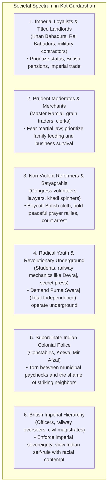
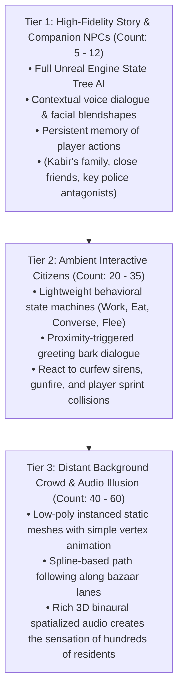

# PROJECT REVOLUTION — NPCs, Social Strata & Living World Systems

**Target Engine:** Unreal Engine 5 (AI State Trees, Mass Entity Crowd Baseline)  
**Setting:** Kot Gurdarshan, Central Punjab (1919 – 1929)  
**Design Philosophy:** Grounded Living World Simulation (Scalable for Small Team & 16 GB RAM)  
**Author:** Lead Systems Designer & Narrative Designer  
**Date:** October 10, 2026  

---

## 1. Social Strata & Competing Perspectives

Kot Gurdarshan is not a monolithic cartoon. Indian society under the Raj was intensely complex, divided by economic interests, risk tolerance, caste, and ideology. The town's residents reflect six distinct worldviews:



---

## 2. Diurnal Cycles & NPC Schedules

In an authentic living world, characters do not stand idle waiting for player interaction. The town shifts across five realistic daily phases:

```mermaid
timeline
    title Daily Life Schedule in Kot Gurdarshan
    04:30 - 07:00 : Dawn (Brahma Muhurta) : Temple bells, Azaan, sweeping courtyards, fetching well water, milk delivery
    07:00 - 13:00 : Morning Commercial Rush : School starts, bazaar shutters open, grain weighing at Mandi, railway departures
    13:00 - 16:00 : Midday Afternoon Slump : Blinding heat, shopkeepers nap on charpais, silent alleys, dogs in shade
    16:00 - 19:30 : Evening Resurgence : School releases, wrestling in akhara, frying samosas, lighting kerosene lamps
    19:30 - 04:30 : Night & Curfew : Police boots on brick, chowkidar calls, locked gates, secret rooftop couriers
```

### Phase Details:
1. **Dawn (4:30 AM – 7:00 AM):** 
   - Low mist. Sound of sweeping broom bristles on brick. Earthenware water pots clinking at the mohalla well. Kabir's mother Parvati lighting the clay stove (*chulha*). Smoke rising straight into cold morning air.
2. **Morning Rush (7:00 AM – 1:00 PM):**
   - The street wakes. Wooden shutters clatter up. Kabir walks to school with his brass tiffin box. Bullock carts laden with golden wheat enter from the canal road. Tongas clatter toward the railway station.
3. **Midday Slump (1:00 PM – 4:00 PM):**
   - 42°C summer heat. Streets empty. Cotton curtains (*chicks*) lowered across shopfronts. Crows caw lazily from parapets. Ideal window for covert traversal when street witnesses are minimal.
4. **Evening Resurgence (4:00 PM – 7:30 PM):**
   - The bazaar hums with life. Halwai frying sizzling sweet jalebis. Young men training in the mud wrestling pit (*akhara*). Elders gathered at the chopal smoking hookahs and discussing Lahore newspapers.
5. **Night & Curfew (7:30 PM – 4:30 AM):**
   - In 1919 (Act I), the curfew siren sounds from the clock tower. Heavy wooden mohalla gates are bolted shut. British mounted patrols and Indian constables with brass-tipped lathis march through empty streets. Lanterns in civilian homes are extinguished. Underground couriers operate across the dark rooftops.

---

## 3. Scalable Technical Architecture for NPC Simulation (16 GB RAM Budget)

To prevent GPU/CPU bottlenecking on our Intel i5-10200H (4 cores) and 16 GB RAM, NPC simulation is stratified into a **Three-Tier Density Architecture**:



---

## 4. Implemented Historical Archetypes (`ACivilianNPCActor`)

In Phase 4, five foundational Punjabi characters were implemented in C++ (`ACivilianNPCActor`) and placed into `L_Validation_Gym.umap`:

| Archetype Name | Historical Profession & Role | Map Location | In-Engine Accessory | Primary Lore & Perspective |
| :--- | :--- | :--- | :--- | :--- |
| **Ram Lubhaya** | Master Tailor / Kabir's Father | Zone A Veranda $(200, 480, 88)$ | `SM_Prop_SewingMachine_Singer` | Traumatized by the loss of his brother in the Great War; urges caution while resisting imperial taxation. |
| **Ghasita Bhishti** | Traditional Water-Carrier | Zone C Well Square $(-80, 1320, 88)$ | `SM_Prop_Bhishti_Mashk` | Generational Muslim water-carrier; embodies the shared community solidarity of pre-partition Punjab. |
| **Hira Halwai** | Chai & Jalebi Stall Owner | Zone D Grand Bazaar $(-200, 1680, 88)$ | `SM_Prop_ClayChaiCup_Kulhad` | Outspoken bazaar merchant whose samovar is the center of local political debate and police warnings. |
| **Lala Karam Chand** | Textile Merchant | Zone D Mandi Street $(200, 1980, 88)$ | `SM_Prop_ClothRolls_Manchester` | Torn between unsold British Manchester cotton inventory and the rising moral tide of Swadeshi boycott. |
| **Pandit Kashi Ram** | Vernacular Middle School Headmaster | District C Schoolyard $(1350, 1420, 88)$ | `SM_School_Blackboard_Easel` | Scholar who teaches that critical inquiry and universal literacy are the ultimate weapons of independence. |

Each character features:
- **Proximity Awareness:** Smoothly rotates toward Kabir when he walks within $2.8\text{ meters}$.
- **Ambient Historical Barks:** Spoken/subtitled lines in authentic Punjab English with local cultural terms (*Hartal*, *Mashk*, *Puttar*, *Chai*, *Manchester*, *Rowlatt Act*).
- **Direct Interaction:** Interacting with 'E' brings up multi-line dialogues and records historical discoveries in Kabir's Satchel Journal.

