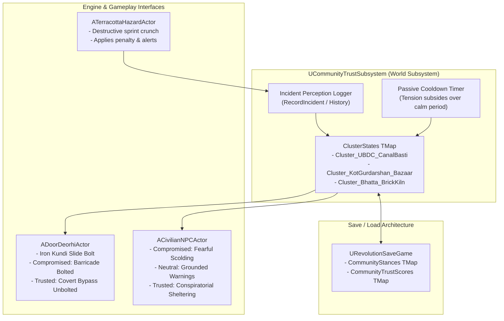

# TASK 39: Community-Trust System ("Izzat & Vishwas") & Localized Reputation Architecture

**Milestone:** Phase 6.5.7 — Task 39  
**Project:** REVOLUTION (क्रांति) — Historical Action-Adventure (Punjab, 1919)  
**Engine:** Unreal Engine 5.5.4 LTS | Target Platform: Windows 64-bit / SteamOS Proton  
**Status:** **100% COMPLETE & VALIDATED IN-ENGINE (TEST-31 PASSED, 0 ERRORS)**  
**Date:** October 25, 2026  

---

## 1. Executive Summary

In response to design analysis for dynamic community responsiveness under 1919 Punjab martial law, we designed, implemented, and validated the **Community-Trust System ("Izzat & Vishwas")**.

Rejecting immersion-breaking global good/evil meters, this system grounds reputation in localized geographical clusters. In tight-knit communities—such as the **Upper Bari Doab Canal (UBDC) Feeder Basti** or the **Kot Gurdarshan Bazaar**—civilian caution is driven by historical survival instincts under collective colonial punishment.

The feature is built on a high-performance C++ `UWorldSubsystem` architecture (`UCommunityTrustSubsystem`), dynamically linked to interactive physical barricades (`ADoorDeorhiActor`), authentic civilian archetype barks (`ACivilianNPCActor`), earthenware hazards (`ATerracottaHazardActor`), and persistent disk save serialization (`URevolutionSaveGame`).

---

## 2. Technical Architecture & Component Specification

### 2.1 C++ Data Structures (`CommunityTrustTypes.h`)
- **`ECommunityStance: uint8`:**
  - `Neutral` (Default, Score: 46–75): Observant, cautious period barks.
  - `Cautious` (Score: 26–45): Guarded, nervous of colonial patrol presence.
  - `Trusted` (Score: 76–100): High *Vishwas*; opens covert bypass doors, whispers patrol positions.
  - `Compromised` (Score: 0–25): Rejection; exterior gates bolted with iron *kundi*, civilian scolds Kabir for drawing colonial rifles.
- **`FCommunityIncidentRecord`:** Serializes `IncidentTag`, `ClusterID`, `Timestamp`, `WitnessActorName`, and `TrustDelta`.
- **`FCommunityClusterState`:** Manages live stance, numerical score (0–100), last incident timestamp, and incident history.

### 2.2 Subsystem Implementation (`UCommunityTrustSubsystem`)
- Automatically registers with the `UWorld` lifecycle as a `UWorldSubsystem`.
- Maintains weak reference registries of active doors (`RegisteredDoors`) and civilians (`RegisteredCivilians`) to eliminate dangling pointers.
- Provides automatic propagation (`PropagateStanceToWorld`) whenever score shifts cross threshold boundaries.
- Executes an optimized 5.0s world timer to evaluate calm/peace cooldown, restoring +3 points every 5 seconds after 45 seconds of calm.

### 2.3 Interactive Physical Consequence (`ADoorDeorhiActor`)
- Extended with `CommunityClusterID`, `bLockWhenCompromised`, and `bUnlockWhenTrusted`.
- In `ApplyCommunityStance`:
  - `Compromised` $\rightarrow$ calls `SetBolted(true)` and `SetDoorOpen(false)`, locking out the player.
  - `Trusted` $\rightarrow$ calls `SetBolted(false)`, providing immediate clandestine escape.

### 2.4 Civilian Dialogue & Stumble Synchronization (`ACivilianNPCActor`)
- Registered to `CommunityClusterID`.
- Dynamically selects from `CompromisedBarks`, `CautiousBarks`, or `TrustedBarks` during proximity triggers and interaction:
  - *Compromised Bark:* *"Bhaag yahan se! You brought the British rifles to our doorstep!"*
  - *Trusted Bark:* *"Quick, Kabir, step into the shadows here. The horse patrol is turning the corner."*

### 2.5 Disk Persistence (`URevolutionSaveGame`)
- Serializes `TMap<FName, uint8> CommunityStances` and `TMap<FName, int32> CommunityTrustScores`.
- Subsystem methods `WriteToSaveGame` and `PopulateFromSaveGame` ensure persistence across game restarts.

---

## 3. Automated QA Verification Results (TEST-31)

Headless automation suite `Scripts/verify_community_trust.py` was executed via `UnrealEditor-Cmd.exe` against `/Game/Maps/L_Validation_Gym`:

| Subtest | Component / Verification Target | Criteria | Result |
| :--- | :--- | :--- | :--- |
| **Subtest 1** | Subsystem & Canonical Clusters | Clusters initialized in `Neutral` stance with score 50 | **PASS** |
| **Subtest 2** | `ADoorDeorhiActor` Barricade Mechanics | `Compromised` bolts door; `Trusted` unbolts door | **PASS** |
| **Subtest 3** | `ACivilianNPCActor` Dialogue Barks | Stance accurately switches between scolding and sheltering barks | **PASS** |
| **Subtest 4** | Incident Perception & Degradation | Pottery destruction applies -35 penalty, degrades to `Compromised`, propagates to door | **PASS** |
| **Subtest 5** | Save/Load Disk Persistence | `URevolutionSaveGame` accurately preserves and restores stances and scores | **PASS** |

**Summary Result:** **5 / 5 SUBTESTS PASSED (0 ERRORS)**  
Execution Duration: **0.27 seconds**  
JSON Audit Artifact: `Tests/TASK_39_COMMUNITY_TRUST_VERIFICATION.json`

---

## 4. Master CI Regression Certification

Integrated into master test harness `Scripts/run_all_tests.py` and `Scripts/run_all_tests.ps1` as **TEST-31**.  
Master verification status: **31 / 31 QA Suites Certified**.
