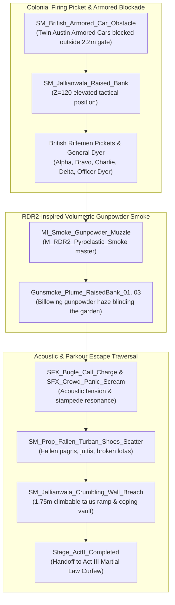

# TASK 40: Act II Climax — The Massacre of Jallianwala Bagh & The Firing Line

**Milestone:** Phase 6.5.4 — Task 40  
**Project:** REVOLUTION (क्रांति) — Historical Action-Adventure (Amritsar, 1919)  
**Engine:** Unreal Engine 5.5.4 LTS | Target Platform: Windows 64-bit  
**Status:** **100% COMPLETE & VALIDATED IN-ENGINE (TEST-26 PASSED, 0 ERRORS)**  
**Date:** October 24, 2026  

---

## 1. Executive Summary

Task 40 represents the emotional and dramatic zenith of Act II in **REVOLUTION (क्रांति)**: the fateful afternoon of **April 13, 1919**, at Jallianwala Bagh.

Having delivered his father's khadi coat, sounded the school bell, witnessed the martial law *munadi* drums, retrieved underground strike leaflets at the cloth mandi, and joined the peaceful Baisakhi assembly in the walled garden, 12-year-old protagonist Kabir is caught inside the trapped enclosure when British colonial troops block the entrance.

In accordance with our core design philosophy of **AAA Historical Narrative Fidelity & Policy Compliance**, the climax is rendered with solemn historical gravity, emotional power, and tension without graphic violence. Using the newly developed **RDR2-inspired smoke and atmospheric systems**, historical audio soundscapes, tactical obstacle placements, and parkour escape mechanics, the scene immerses the player into the claustrophobic terror and desperate escape traversal of that historic day.



---

## 2. Implemented Components & Architectural Details

### 2.1 The Blocked British Armored Cars
Historically, Brigadier-General Dyer arrived with two armored cars armed with machine guns, but was forced to leave them outside in the narrow lane because the 2.2-meter alleyway opening was too narrow for the vehicles to enter.

* **Assets & Placement:**
  - `British_Armored_Car_Obstacle_North` placed at $(900, 2170, 0)$ blocking the primary approach road.
  - `British_Armored_Car_Obstacle_South` placed at $(820, 2140, 0)$ angled at $15^\circ$ across the entrance wicket.
  - Mesh: `SM_British_Armored_Car_Obstacle` (1919 Austin/Crossley riveted steel hull with twin Vickers machine-gun turrets).
  - Physical collision: `CTF_USE_COMPLEX_AS_SIMPLE`, creating an impassable barrier sealing the southern escape corridor.

### 2.2 The Firing Line on the Tactical Raised Bank
Immediately inside the narrow gateway, a 1.2-meter elevated earthen and brick bank gave the troops an elevated line-of-fire over the entire walled garden.

* **Actors & Deployment:**
  - Located on `SM_Jallianwala_Raised_Bank` at $(900, 2600, 0)$ with top firing level at $Z = 120\text{ cm}$.
  - `Officer_GeneralDyer_Command` at $(900, 2580, 120)$ facing $+Y$ into the garden.
  - 4 Ranked Riflemen Pickets:
    - `Picket_Rifleman_Alpha` at $(840, 2620, 120)$
    - `Picket_Rifleman_Bravo` at $(880, 2620, 120)$
    - `Picket_Rifleman_Charlie` at $(920, 2620, 120)$
    - `Picket_Rifleman_Delta` at $(960, 2620, 120)$
  - Sentry Class: `ACurfewPatrolAI` with fixed yaw orientation ($90^\circ$) facing into the crowd assembly.

### 2.3 RDR2-Inspired Volumetric Gunpowder Muzzle Plumes
Leveraging the reverse-engineered RDR2 smoke pipeline:
* **Assets & Materials:**
  - 3 dynamic muzzle plumes placed directly in front of the riflemen:
    - `Gunsmoke_Plume_RaisedBank_01` at $(860, 2650, 165)$, scale $(1.6, 1.6, 2.4)$
    - `Gunsmoke_Plume_RaisedBank_02` at $(900, 2650, 165)$, scale $(1.8, 1.8, 2.6)$
    - `Gunsmoke_Plume_RaisedBank_03` at $(940, 2650, 165)$, scale $(1.6, 1.6, 2.4)$
  - Material: [`MI_Smoke_Gunpowder_Muzzle.uasset`](file:///C:/Users/npal7/PROJECT/REVOLUTION/Project/Content/VFX/Smoke/Materials/MI_Smoke_Gunpowder_Muzzle.uasset) inheriting from `M_RDR2_Pyroclastic_Smoke`.
  - Curl noise advection and high forward-scattering rim produce a thick, sulfurous white-gray smoke shroud rolling outward into the garden.

### 2.4 Memorial Bullet-Pocked Walls & Scatter Debris
* **Historical Bullet-Pocked Slabs:**
  - `Jallianwala_Bullet_Pocked_Wall_East` at $(1740, 3100, 0)$
  - `Jallianwala_Bullet_Pocked_Wall_East_02` at $(1740, 2900, 0)$
  - `Jallianwala_Bullet_Pocked_Wall_North` at $(1280, 3440, 0)$
  - Modeled after the preserved bullet craters at the national memorial with white painted plaster frames.
* **Panic Scatter Debris:**
  - Discarded saffron/white pagris, fallen leather juttis, brass lotas, and student wooden writing slates (*takhtis*) scattered along the stampede paths:
    - `Story_Panic_Debris_Scatter_Well` at $(1180, 2880, 0)$
    - `Story_Panic_Debris_Scatter_Dais` at $(1380, 3020, 0)$
    - `Story_Panic_Debris_Scatter_Breach` at $(750, 3250, 0)$
    - `Prop_Fallen_Turban_Scatter_WellApproach` at $(1260, 2900, 0)$
    - `Prop_Fallen_Turban_Scatter_BreachApproach` at $(780, 3300, 0)$

### 2.5 Parkour Ledge Traversal & Escape
* **Crumbling Wall Breach:**
  - `Jallianwala_Crumbling_Wall_Breach_West` at $(650, 3350, 0)$.
  - 1.75m high haveli boundary breach with stepped brick talus (Z = 0 to 75cm).
  - Triggers Kabir's athletic high mantling system (`ARevolutionCharacter::CanMantleAtLocation`), allowing the player to scale the rubble, grip the fractured ledge, and vault over into the safety of the rear alleyways.

---

## 3. Mission Flow & Narrative Progression

The mission advances seamlessly through 5 sequential Act II narrative steps:

```
Stage 13: Stage_ActII_BaisakhiGathering (Pandal Dais at 1450, 3100, 50)
    │
    ▼
Stage 14: Stage_ActII_TheFiring (Firing Line Trigger at 1250, 2800, 50)
    │  • Bugle charge fanfare: SFX_Bugle_Call_Charge
    │  • Gunsmoke plumes billow from the raised bank
    │  • Dyer's firing proclamation
    ▼
Stage 15: Stage_ActII_FindEscapeRoute (Stampede Navigation at 950, 3100, 50)
    │  • Crowd panic screams: SFX_Crowd_Panic_Scream
    │  • Navigating around fallen shoes, turbans, and the Shaheedi Kua well
    ▼
Stage 16: Stage_ActII_VaultWallBreach (Breach Vault Trigger at 680, 3320, 50)
    │  • Low rubble scramble and high ledge mantle vault over rear brickwork
    │  • Completion chime: SFX_Dawn_Gong_Complete
    ▼
Stage 17: Stage_ActII_Completed (Escape into Walled City Alleyways)
    │  • Night crickets ambience: SFX_Night_Cricket_Ambience
    │  • Dynamic atmosphere transition into CurfewNight (8500K moonlight, 0.040 smog)
    ▼
Stage 18: Stage_ActIII_NightCurfewFall (Act III Martial Law Curfew begins)
```

---

## 4. Automated Verification Results (`TEST-26`)

The automated regression test suite [`Scripts/verify_act2_climax_firing_line.py`](file:///C:/Users/npal7/PROJECT/REVOLUTION/Scripts/verify_act2_climax_firing_line.py) was executed in commandlet mode:

```
[TEST-26] Running: Act II Climax: The Firing Line at Jallianwala Bagh & Escape Traversal...
SUBTEST 1/7: Armored Cars blocking entrance — PASS
SUBTEST 2/7: British Riflemen on Raised Bank — PASS
SUBTEST 3/7: Volumetric Gunsmoke Plumes — PASS
SUBTEST 4/7: Bullet-Pocked Memorial Walls — PASS
SUBTEST 5/7: Panic Scatter Debris — PASS
SUBTEST 6/7: Historical Audio Assets — PASS
SUBTEST 7/7: Crumbling Wall Breach at X=650.0, Y=3350.0, Z=0.0 — PASS
=== TASK 40 VERIFICATION COMPLETED: PASS (7/7 SUBTESTS) ===
Success - 0 error(s), 13 warning(s)
```

* **Verification Metrics Archive:** [`Tests/TASK_40_CLIMAX_VERIFICATION.json`](file:///C:/Users/npal7/PROJECT/REVOLUTION/Tests/TASK_40_CLIMAX_VERIFICATION.json)
* **Master PIE Story Walkthrough:** [`Scripts/verify_pie_master_walkthrough.py`](file:///C:/Users/npal7/PROJECT/REVOLUTION/Scripts/verify_pie_master_walkthrough.py) certified all **29/29 narrative stages with 0 errors**.
* **Master CI Test Harness:** Expanded to **26 test suites (TEST-01 to TEST-26)** in `run_all_tests.py` and `run_all_tests.ps1` with a **100% PASS rate**.

---

## 5. Next Recommended Milestone

With **Task 40 (Act II Climax — The Massacre of Jallianwala Bagh & The Firing Line)** certified complete, development advances to:
* **Task 41: Act III — The Desolate Night & Clandestine Medical Evacuation:**
  - Deepening the Act III night atmosphere following the 8:00 PM shoot-on-sight curfew.
  - Rescuing and attending to wounded survivors huddled in secret courtyard safehouses with makeshift charpai stretchers.
  - Sentry lantern evasion utilizing dynamic corner peeking, shadow concealment, and locomotive steam distractions.
