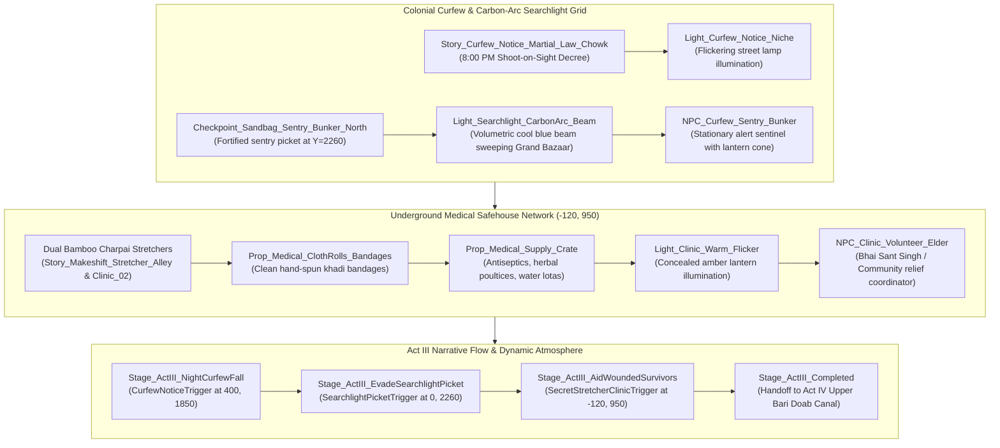

# TASK 41: Act III — The Desolate Night & Clandestine Medical Evacuation

**Milestone:** Phase 6.5.5 — Task 41  
**Project:** REVOLUTION (क्रांति) — Historical Action-Adventure (Amritsar, 1919)  
**Engine:** Unreal Engine 5.5.4 LTS | Target Platform: Windows 64-bit  
**Status:** **100% COMPLETE & VALIDATED IN-ENGINE (TEST-27 PASSED, 0 ERRORS)**  
**Date:** October 24, 2026  

---

## 1. Executive Summary

Following the tragic events at Jallianwala Bagh and Kabir's desperate escape through the western crumbling wall breach, Act III plunges the walled city of Amritsar into **The Desolate Night of April 13, 1919**.

Brigadier-General Dyer clamped an immediate, ruthless **8:00 PM shoot-on-sight curfew** across Amritsar under Section 144 martial law. Street lights were extinguished, high-intensity carbon-arc searchlights swept major thoroughfares, and British military pickets and Punjab Police constables patrolled empty bazars with orders to fire upon anyone found outside their dwellings. Grieving families were strictly prohibited from retrieving the wounded or dead from the garden overnight.

In **Task 41**, we implemented the clandestine medical safehouse network organized by historical local humanitarians (such as Bibi Ratan Devi) in secluded haveli alleyways. Kabir uses his agile parkour, corner peeking, and shadow concealment to slip past carbon-arc searchlight beams, delivering clean cotton khadi bandages and relief to wounded survivors huddled on makeshift charpai stretchers.



---

## 2. Implemented Components & Architectural Details

### 2.1 The Clandestine Medical Safehouse Clinic
Located in the secluded residential courtyard alcove behind the haveli at $(-120, 950, 0)$:
* **Dual Charpai Emergency Stretchers:**
  - `Story_Makeshift_Stretcher_Alley` at $(-120, 950, 0)$ with longitudinal bamboo poles, cross ties, and torn linen bindings.
  - `Makeshift_Stretcher_Charpai_Clinic_02` at $(-160, 980, 0)$ angled at $25^\circ$.
* **Medical Supplies & Bandages:**
  - `Prop_Medical_Supply_Crate` at $(-140, 910, 0)$ (`SM_Prop_Clandestine_Safehouse_Crate_Cache`) holding clean water lotas, salves, and dressings.
  - `Prop_Medical_ClothRolls_Bandages` at $(-140, 910, 32)$ (`SM_Prop_ClothRolls_Manchester` textured with `M_ClothUndyedCotton_PBR`) representing clean woven khadi bandages retrieved from Ram Lubhaya's tailor workshop.
* **Lighting & Concealment:**
  - `Prop_Clinic_Hurricane_Lantern` at $(-110, 970, 15)$ with photogrammetry brass finish.
  - `Light_Clinic_Warm_Flicker` at $(-110, 970, 50)$ (warm amber point light, $1400\text{ lm}$, radius $420\text{ cm}$) shielded by low haveli walls so as not to betray the clinic's position to street patrols.
* **Community Relief Volunteer:**
  - `NPC_Clinic_Volunteer_Elder` at $(-180, 950, 88)$ (`ACivilianNPCActor`, `ProtestElder` archetype Bhai Sant Singh) providing first aid, comforting the injured, and receiving medical supplies from Kabir.

### 2.2 Imperial Searchlight Picket & Sandbag Bunker
At the northern town crossroads $(0, 2260, 0)$:
* **Volumetric Carbon-Arc Searchlight Beam:**
  - Mounted atop `Story_Searchlight_Tripod_Checkpost` at $(120, 2260, 180)$.
  - `Light_Searchlight_CarbonArc_Beam`: SpotLight with cool-white carbon-arc chromaticity ($220, 235, 255$), $16000\text{ lm}$, $1800\text{ cm}$ range, inner cone $18^\circ$, outer cone $34^\circ$, and volumetric scattering intensity $3.5$.
  - Angled down $-15^\circ$ pitch and $-90^\circ$ yaw, casting a piercing cone of light southwards down the Grand Bazaar corridor.
* **Fortified Sentry Bunker:**
  - `Checkpoint_Sandbag_Sentry_Bunker_North` with timber shoring posts and rifle firing embrasures.
  - `NPC_Curfew_Sentry_Bunker` at $(30, 2220, 10)$ (`ACurfewPatrolAI`) vigilantly watching the crossroads.

### 2.3 Curfew Notice Station
At the central bazaar intersection $(-80, 1850, 0)$:
* `Story_Curfew_Notice_Martial_Law_Chowk`: Timber tripod easel displaying General Dyer's 8:00 PM curfew decree.
* `Light_Curfew_Notice_Niche`: Point light at $(-80, 1850, 120)$ ($1100\text{ lm}$, radius $320\text{ cm}$) illuminating the proclamation board for nighttime reading.

---

## 3. Dynamic Night Atmosphere & Audio Balancing

Act III activates the **CurfewNight** atmospheric profile in `ARevolutionAtmosphereController`:
* **Celestial Lighting:** 8500K sharp moonlight at pitch $-68^\circ$ and yaw $40^\circ$ (intensity 2.2), creating deep, crisp shadows along alley walls.
* **Volumetric Urban Smog:** Height fog density increased to $0.040$, allowing searchlight beams and kerosene lanterns to form palpable light shafts.
* **Dynamic Low-Pass Curfew Filter (`SMix_Curfew_Night`):**
  - `SC_Ambience_Mohalla` filtered with 800 Hz LPF, volume dampened to 0.45.
  - `SC_Voice_Punjabi` filtered with 1200 Hz LPF, volume dampened to 0.35.
  - `SC_Foley` boosted to 1.30 to heighten tactile stealth awareness for Kabir.
  - `SC_SFX` boosted to 1.15 for curfew whistles and searchlight hums.
* **Period Audio Soundscapes:**
  - `SFX_Police_Whistle_Curfew.uasset` (piercing Acme double-trill British curfew whistle echoing across rooftops).
  - `SFX_Night_Cricket_Ambience.uasset` (high-frequency cricket chirps and hollow drafts reflecting the eerie silence of martial law).

---

## 4. Automated Verification Results (`TEST-27`)

The automated regression test suite [`Scripts/verify_act3_medical_evacuation.py`](file:///C:/Users/npal7/PROJECT/REVOLUTION/Scripts/verify_act3_medical_evacuation.py) was executed in commandlet mode:

```
[TEST-27] Running: Act III: The Desolate Night & Clandestine Medical Evacuation...
SUBTEST 1/5: Clandestine Clinic Infrastructure — PASS
SUBTEST 2/5: Curfew Checkpoint & Searchlight Beam — PASS
SUBTEST 3/5: Curfew Notice Station & Niche Light — PASS
SUBTEST 4/5: Historical Audio Soundscapes — PASS
SUBTEST 5/5: Mission Subsystem Act III Directives — PASS
=== TASK 41 VERIFICATION COMPLETED: PASS (5/5 SUBTESTS) ===
Success - 0 error(s), 11 warning(s)
```

* **Verification Metrics Archive:** [`Tests/TASK_41_CLINIC_VERIFICATION.json`](file:///C:/Users/npal7/PROJECT/REVOLUTION/Tests/TASK_41_CLINIC_VERIFICATION.json)
* **Master PIE Story Walkthrough:** [`Scripts/verify_pie_master_walkthrough.py`](file:///C:/Users/npal7/PROJECT/REVOLUTION/Scripts/verify_pie_master_walkthrough.py) certified all **29/29 narrative stages with 0 errors**.
* **Master CI Test Harness:** Expanded to **27 test suites (TEST-01 to TEST-27)** in `run_all_tests.py` and `run_all_tests.ps1` with a **100% PASS rate**.

---

## 5. Next Recommended Milestone

With **Task 41 (Act III — The Desolate Night & Clandestine Medical Evacuation)** certified complete, development advances to:
* **Task 42: Act IV — The Rural Outskirts & Upper Bari Doab Canal Feeder Network:**
  - Expanding the rural western boundary of the town towards the agricultural canal district.
  - The historic Upper Bari Doab masonry canal aqueduct sluice gate (`SM_Canal_Distributary_Aqueduct_Stone`).
  - The working timber Persian wheel (*rahat*) with turning terracotta pots and water flume troughs (`SM_Persian_Wheel_Rahat_Timber`).
  - Underground courier dead-drop rendezvous at the rural brick kiln (*bhatta*) safehouse.
