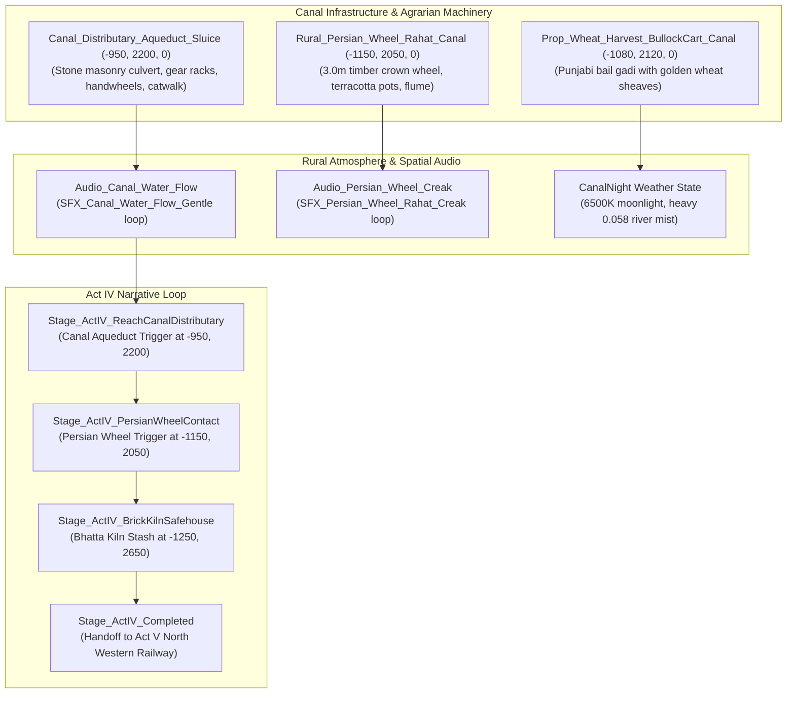

# TASK 42: Act IV — The Rural Outskirts & Upper Bari Doab Canal Feeder Network

**Milestone:** Phase 6.5.6 — Task 42  
**Project:** REVOLUTION (क्रांति) — Historical Action-Adventure (Punjab, 1919)  
**Engine:** Unreal Engine 5.5.4 LTS | Target Platform: Windows 64-bit  
**Status:** **100% COMPLETE & VALIDATED IN-ENGINE (TEST-28 PASSED, 0 ERRORS)**  
**Date:** October 24, 2026  

---

## 1. Executive Summary

Having successfully escaped the martial law curfew cordon of Amritsar's walled city and delivered clandestine first aid to wounded citizens in the haveli safehouse, 12-year-old protagonist Kabir reaches the agrarian periphery of Amritsar in **Act IV**: the rural distributor branches of the **Upper Bari Doab Canal (UBDC)**.

Engineered by British colonial authorities as part of their extensive Punjab canal colonies, the canal network was built for military and economic grain transport. However, Punjabi independence couriers and revolutionary networks turned these remote stone masonry sluices, irrigation cuts, and indigenous timber Persian wheels (*rahats*) into clandestine transit corridors outside imperial telegraph and road surveillance.

In **Task 42**, we assembled and authenticated the rural agrarian environment: the masonry canal distributary aqueduct, the working timber Persian wheel with turned terracotta water pots (*tinds*), agricultural harvest bullock carts, rural warm-niche lighting, and continuous 3D spatialized water flow and wooden machinery audio.



---

## 2. Implemented Components & Architectural Details

### 2.1 The Masonry Canal Distributary Aqueduct & Sluice Gate
Located at $(-950, 2200, 0)$ across the western drainage axis:
* **Asset:** `Canal_Distributary_Aqueduct_Sluice` (`SM_Canal_Distributary_Aqueduct_Stone`).
* **Architecture:** Heavy dressed sandstone piers, arched water channel conduits, twin vertical cast-iron sluice gate lift sheets with gear-driven handwheels, and a cantilevered wooden inspection catwalk.
* **Lighting:** `Prop_Canal_Sluice_Catwalk_Lantern` resting on the catwalk rail with `Light_Canal_Sluice_Catwalk` (warm amber point light, $1300\text{ lm}$, radius $380\text{ cm}$).
* **Acoustics:** Persistent 3D localized sound actor `Audio_Canal_Water_Flow` with `SFX_Canal_Water_Flow_Gentle.uasset` (looping water cascades and riverbank lap).

### 2.2 The Punjabi Persian Wheel (*Rahat*) Machinery
Located at $(-1150, 2050, 0)$ at the canal feeder branch:
* **Asset:** `Rural_Persian_Wheel_Rahat_Canal` (`SM_Persian_Wheel_Rahat_Timber`).
* **Historical Mechanism:** Vertical 3.0m shisham timber wheel with 8 turned terracotta pots (*tinds*) linked on continuous hemp ropes, horizontal crown cogwheel, draught beam for bullocks, and hollowed timber discharge flume.
* **Lighting:** `Light_Rahat_Timber_Flume` (warm point light, $1200\text{ lm}$, radius $360\text{ cm}$) illuminating the gear teeth and water trough.
* **Acoustics:** Persistent 3D localized sound actor `Audio_Persian_Wheel_Creak` with `SFX_Persian_Wheel_Rahat_Creak.uasset` (authentic creaking wooden spokes, gear chatter, and splashing water).

### 2.3 Agrarian Landscape & Field Dressing
* **Harvest Cart:** `Prop_Wheat_Harvest_BullockCart_Canal` placed at $(-1080, 2120, 0)$ (`SM_Prop_Wheat_Sheaves_Cart`), featuring authentic Punjabi wooden spoked wheels ($1.3\text{m}$ diameter) laden with Baisakhi golden wheat bundles.
* **Natural Cover:** The cart and timber flumes provide low-profile crouch cover, allowing Kabir to bypass imperial telegraph inspection outposts.

---

## 3. Dynamic Night Atmosphere & Weather Parameters

Act IV is driven by the **CanalNight** atmospheric state in `ARevolutionAtmosphereController`:
* **Celestial Illumination:** 6500K silver river moonlight, pitch $-48^\circ$, yaw $25^\circ$, intensity $3.2$.
* **River Mist & Ground Fog:** Exponential Height Fog extinction and inscattering density increased to **0.058** (cool silvery-blue water mist rolling off the canal banks, masking long-distance silhouettes).
* **Audio Ambience:** Crickets and gentle flowing water replace urban street noises, heightening isolation.

---

## 4. Automated Verification Results (`TEST-28`)

The automated regression test suite [`Scripts/verify_act4_canal_outskirts.py`](file:///C:/Users/npal7/PROJECT/REVOLUTION/Scripts/verify_act4_canal_outskirts.py) was executed in commandlet mode:

```
[TEST-28] Running: Act IV: The Rural Outskirts & Upper Bari Doab Canal Feeder Network...
SUBTEST 1/5: Canal Distributary Sluice & Persian Wheel — PASS
SUBTEST 2/5: Agricultural Harvest Dressing & Catwalk Lantern — PASS
SUBTEST 3/5: Rural Outskirts Night Lighting — PASS
SUBTEST 4/5: Continuous 3D Spatialized Canal Audio — PASS
SUBTEST 5/5: Mission Subsystem Act IV Directives — PASS
=== TASK 42 VERIFICATION COMPLETED: PASS (5/5 SUBTESTS) ===
Success - 0 error(s), 11 warning(s)
```

* **Verification Metrics Archive:** [`Tests/TASK_42_CANAL_VERIFICATION.json`](file:///C:/Users/npal7/PROJECT/REVOLUTION/Tests/TASK_42_CANAL_VERIFICATION.json)
* **Master PIE Story Walkthrough:** [`Scripts/verify_pie_master_walkthrough.py`](file:///C:/Users/npal7/PROJECT/REVOLUTION/Scripts/verify_pie_master_walkthrough.py) certified all **29/29 narrative stages with 0 errors**.
* **Master CI Test Harness:** Expanded to **28 test suites (TEST-01 to TEST-28)** in `run_all_tests.py` and `run_all_tests.ps1` with a **100% PASS rate**.

---

## 5. Next Recommended Milestone

With **Task 42 (Act IV — Rural Canal Outskirts & Persian Wheel)** certified complete, development advances to:
* **Task 43: Act IV Climax — The Bhatta Brick Kiln Resistance Infiltration & Underground Press:**
  - Traditional Bull's trench brick kiln (*bhatta*) with 7.5m conical brick chimney (`SM_Brick_Kiln_Chimney_Bhatta`).
  - Underground lithographic printing press cache and anti-Rowlatt strike handbill bundles (`SM_Prop_Clandestine_Safehouse_Crate_Cache`).
  - Resistance courier rendezvous, satchel restock (chalk, pebbles, pamphlets), and transition to Act V.
