# TASK 43: Act IV Climax — Bhatta Brick Kiln Resistance Infiltration & Underground Press

**Milestone:** Phase 6.5.7 — Task 43  
**Project:** REVOLUTION (क्रांति) — Historical Action-Adventure (Punjab, 1919)  
**Engine:** Unreal Engine 5.5.4 LTS | Target Platform: Windows 64-bit  
**Status:** **100% COMPLETE & VALIDATED IN-ENGINE (TEST-29 PASSED, 0 ERRORS)**  
**Date:** October 24, 2026  

---

## 1. Executive Summary

In the climactic sequence of **Act IV: The Agrarian Resistance**, protagonist Kabir navigates past the Upper Bari Doab Canal feeders to the desolate outskirts of Amritsar. Here sits a traditional **Bhatta** (Bull's trench brick kiln) — an expansive industrial earthwork furnace whose towering conical brick chimney belches heavy coal and biomass smoke across the flat Punjabi night.

Beneath the firing trenches and drying stacks, Punjabi freedom fighters and anti-Rowlatt organizers established a clandestine press and courier staging nexus. Using hand-cranked lithographic stone presses sheltered from colonial patrols, activists printed underground pamphlets, strike notices, and emergency warnings informing rural communities of the martial law atrocities inside the walled city.

In **Task 43**, we built, integrated, and verified this critical historical narrative set piece:
1. **The Conical Bhatta Chimney:** 7.5-meter tapered brick masonry stack at `(-1250.0, 2650.0, 0.0)`.
2. **RDR2-Inspired Industrial Smoke Plume:** High-density volumetric smoke plume anchored at the chimney crown (`Z = 780.0`) utilizing `MI_Smoke_Haveli_Chimney` with curl noise turbulent draft.
3. **Subterranean Flue Fire Glow:** Ember orange illumination (`2200 lm`, radius `480 cm`) casting flickering coal-fired warmth across the brick trenches.
4. **Underground Lithographic Press & Supply Cache:** Weathered timber safehouse crate cache, fresh strike handbill bundles, brass hurricane work lantern, and focused task lighting.
5. **Resistance Courier Liaison NPC:** In-engine civilian contact character positioned for the narrative handoff to Act V.

```mermaid
flowchart TD
    subgraph Brick_Kiln_Infrastructure ["Industrial Earthwork & Smoke Optics"]
        A["Industrial_Brick_Kiln_Bhatta_Chimney (-1250, 2650, 0)<br/>(7.5m tapered Bull's trench chimney stack)"]
        B["Smoke_Plume_Bhatta_Kiln (-1250, 2650, 780)<br/>(RDR2-inspired curl-noise volumetric draft plume)"]
        C["Light_Bhatta_Kiln_Flue_Glow (-1250, 2650, 45)<br/>(2200 lm ember orange subsurface flue fire)"]
    end

    subgraph Underground_Press_Cache ["Clandestine Lithographic Press Nexus"]
        D["Story_Clandestine_Safehouse_Supply_Cache (-1180, 2520, 0)<br/>(Lithographic printing press & munition crate cache)"]
        E["Prop_Safehouse_Handbill_Bundles (-1175, 2515, 35)<br/>(Freshly printed strike handbills on khadi paper)"]
        F["Prop_Safehouse_Printing_Lantern & Light (-1160, 2530, 20)<br/>(Brass hurricane lantern, 1350 lm warm task illumination)"]
        G["NPC_Resistance_Courier_Liaison (-1200, 2540, 88)<br/>(Revolutionary contact delivering railway intel)"]
    end

    subgraph Mission_Progress ["Act IV -> Act V Climax Sequence"]
        H["Stage_ActIV_ReachCanalDistributary (-950, 2200)"]
        I["Stage_ActIV_PersianWheelContact (-1150, 2050)"]
        J["Stage_ActIV_BrickKilnSafehouse (-1250, 2650)"]
        K["Stage_ActV_RailwayCuttingClimax (+1000, 3900)"]
    end

    A --> B
    A --> C
    D --> E
    D --> F
    F --> G
    H --> I --> J --> K
```

---

## 2. Implemented Components & Historical Architecture

### 2.1 Conical Bhatta Chimney & Volumetric Smoke Draft
* **Actor:** `Industrial_Brick_Kiln_Bhatta_Chimney` (`SM_Brick_Kiln_Chimney_Bhatta`)
* **Placement:** `(-1250.0, 2650.0, 0.0)`
* **Historical Accuracy:** Reconstructed according to British Indian colonial records of Bull's trench kilns popular throughout Punjab from the late 19th century. Featuring circular firing trenches, damper slots, and a central draft chimney.
* **Volumetric Smoke Plume:** `Smoke_Plume_Bhatta_Kiln` placed at `(-1250.0, 2650.0, 780.0)` using `MI_Smoke_Haveli_Chimney`. Tuned with multi-octave simplex curl noise to replicate the billowing, buoyant ascent of RDR2's factory and locomotive smoke stacks under cold nocturnal winds.

### 2.2 Subterranean Flue Ember Fire Glow
* **Actor:** `Light_Bhatta_Kiln_Flue_Glow`
* **Placement:** `(-1250.0, 2650.0, 45.0)`
* **Parameters:** `LightColor = (255, 120, 25)`, `Intensity = 2200.0 lm`, `AttenuationRadius = 480.0 cm`, with dynamic shadow casting enabled. Simulates the intense subterranean glow radiating through the kiln's subterranean draft vents and flue grates.

### 2.3 Underground Lithographic Press & Clandestine Cache
* **Actor:** `Story_Clandestine_Safehouse_Supply_Cache` (`SM_Prop_Clandestine_Safehouse_Crate_Cache`)
* **Placement:** `(-1180.0, 2520.0, 0.0)`
* **Set Dressing:** 
  - `Prop_Safehouse_Handbill_Bundles` positioned at `(-1175.0, 2515.0, 35.0)` dressed with unbleached desi khadi material (`M_ClothUndyedCotton_PBR`).
  - `Prop_Safehouse_Printing_Lantern` placed at `(-1160.0, 2530.0, 20.0)` with hammered photogrammetry brass (`MI_HammeredBrass_Photogrammetry`).
  - `Light_Safehouse_Printing_Lantern` at `(-1160.0, 2530.0, 60.0)` providing `1350 lm` warm candlelight (`255, 195, 110`).

### 2.4 Resistance Courier Liaison NPC
* **Actor:** `NPC_Resistance_Courier_Liaison` (`CivilianNPCActor`)
* **Placement:** `(-1200.0, 2540.0, 88.0)`, facing rotation `Yaw = 45.0 deg`.
* **Narrative Function:** Receives the player after the canal traversal, acknowledges the delivery of safehouse supplies, and briefs Kabir on the final colonial troop movement departing via the North Western Railway cutting.

---

## 3. Automated In-Engine Verification Results

The automated headless test suite `Scripts/verify_act4_climax_brick_kiln.py` (`TEST-29`) executed via `UnrealEditor-Cmd.exe` against `/Game/Maps/L_Validation_Gym`:

| Subtest | Component / Verification Target | Expected Value / Criteria | Result |
| :--- | :--- | :--- | :--- |
| **Subtest 1** | Bhatta Conical Chimney Actor | `Industrial_Brick_Kiln_Bhatta_Chimney` at $(-1250, 2650, 0)$ | **PASS** |
| **Subtest 2** | RDR2 Industrial Smoke Plume | `Smoke_Plume_Bhatta_Kiln` at $(-1250, 2650, 780)$, `MI_Smoke_Haveli_Chimney` | **PASS** |
| **Subtest 3** | Subterranean Flue Ember Fire Glow | `Light_Bhatta_Kiln_Flue_Glow` intensity $\ge 1500\text{ lm}$, radius $\ge 300\text{ cm}$ | **PASS** |
| **Subtest 4** | Underground Press & Handbill Cache | Cache crate, handbills, brass lantern & task light present | **PASS** |
| **Subtest 5** | Resistance Courier Liaison NPC | `NPC_Resistance_Courier_Liaison` at $(-1200, 2540, 88)$ | **PASS** |

**Summary Result:** **5 / 5 SUBTESTS PASSED (0 ERRORS)**  
JSON Evidence File: `Documentation/test29_act4_climax_brick_kiln_results.json`

---

## 4. Next Milestone: Task 44 (Act V Locomotive & Signal Gantry Climax)

With Act IV fully assembled and verified from the Upper Bari Doab Canal to the Bhatta Brick Kiln press, we advance directly to **Task 44: Act V — North Western Railway Cutting, Signal Gantry & Locomotive Climax**.
