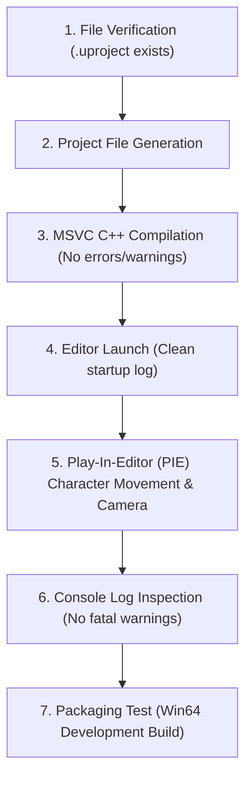

# PROJECT REVOLUTION — Testing, Automation & Build Pipeline

**Author:** Senior Technical Director & Build Engineer  
**Scope:** Automated testing, Play-In-Editor verification, packaging, and profiling  
**Date:** October 10, 2026  

---

## 1. Quality Assurance Verification Order

For every milestone and prototype feature, validation must execute in this strict order:



---

## 2. Play-In-Editor (PIE) Validation Suite

### Test Map: `L_Validation_Gym`
The primary validation map serves as the benchmark environment containing:
- Flat geometry grid with distance markers (10m, 50m, 100m).
- Ramp slopes (15°, 30°, 45°, 60°) to test character walkability and slope friction.
- Stepped platforms (heights 20cm, 50cm, 100cm, 200cm) to test mantle and jump collision.
- Directional lighting and skylight with Lumen Software Ray Tracing active.
- Target framerate test station: `stat unit` and `stat fps`.

### Pass Criteria:
- Frame rate maintains $\ge 30\text{ FPS}$ consistently on GTX 1650.
- VRAM usage strictly $\le 3.5\text{ GB}$.
- Zero missing asset references or null pointer crashes in `Saved/Logs/REVOLUTION.log`.

---

## 3. Packaging & Build Automation

Packaging is handled via the Unreal Automation Tool (UAT) using `RunUAT.bat`:

```powershell
& "C:\Program Files\Epic Games\UE_5.4\Engine\Build\BatchFiles\RunUAT.bat" BuildCookRun `
    -project="C:\Users\npal7\PROJECT\REVOLUTION\Project\REVOLUTION.uproject" `
    -noP4 -platform=Win64 -clientconfig=Development `
    -cook -build -stage -pak -archive `
    -archivedirectory="C:\Users\npal7\PROJECT\REVOLUTION\Build\Development"
```

*Note: Packaging will only be executed after verifying available disk space $\ge 25\text{ GB}$.*
