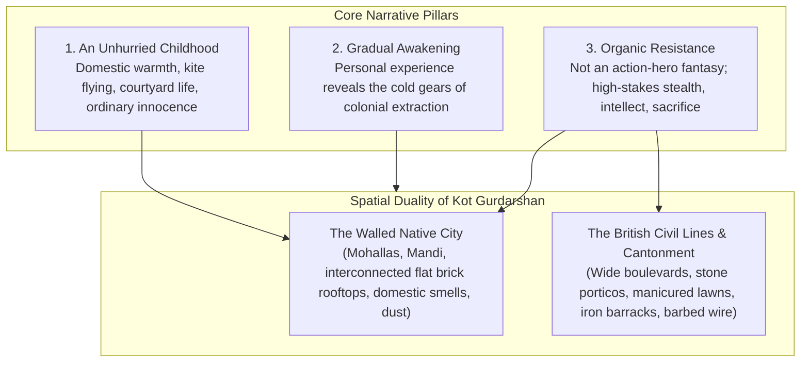
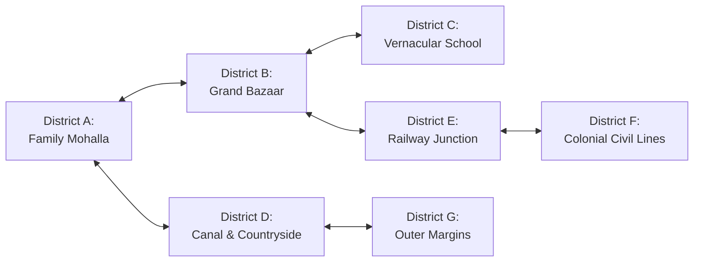
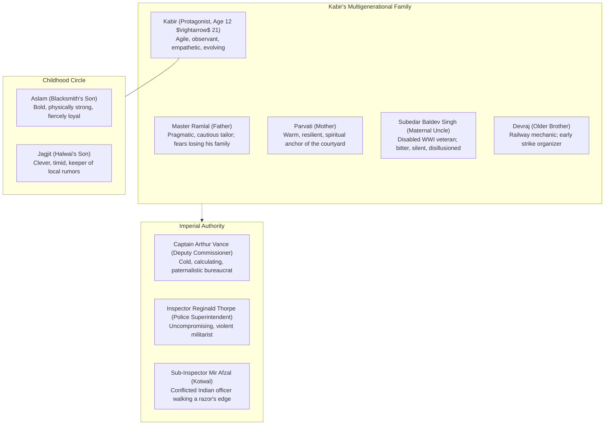
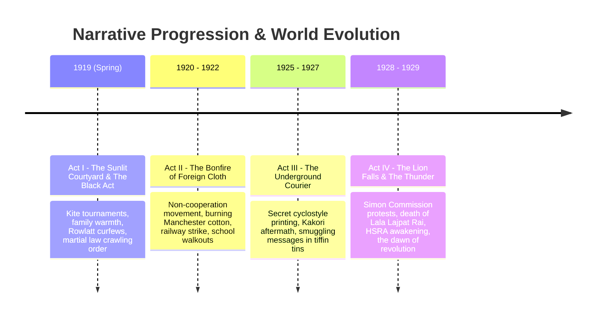

# PROJECT REVOLUTION — Master World Bible

**Setting:** Kot Gurdarshan, Central Punjab, British-ruled India  
**Timeframe:** 1919 – 1929 (From the Rowlatt Act / Martial Law to the Simon Commission & HSRA Awakening)  
**Visual Style Target:** Grounded Historical Realism (Inspired by *Sardar Udham*, *Pather Panchali*, and period archival photography)  
**Classification:** Authoritative World Bible  
**Author:** Creative Director, Historical Researcher & Narrative Lead  
**Date:** October 10, 2026  

---

## 1. Executive Concept & World Premise

**REVOLUTION** is a third-person, historically grounded open-world action-adventure set in the fictional town of **Kot Gurdarshan**, Central Punjab, between 1919 and 1929.

The player controls **Kabir**, who begins the story as a lively, curious 12-year-old boy living with his multigenerational artisan family. The world is not introduced as a warzone or a textbook lecture. It begins as a living, vibrant home: the aroma of boiling chai and spiced lentils in the open courtyard, the whistling of kites battling in high winter skies, the rhythm of his father's foot-pedal sewing machine, and the boisterous banter of the grain market.

The horror of colonial oppression is discovered organically. It is not an abstract concept; it is the confiscation of a neighbor's cooking pots for unpaid land revenue, the humiliation of an uncle who shed blood for the British Empire in the trenches of Mesopotamia only to be forced to crawl on his stomach in his own street, the sudden curfew sirens silencing the evening bazaar, and the violent crack of police lathis against unarmed protestors.

As Kabir grows from an agile child into a resolute young man of 21, the world around him changes. The player discovers alongside Kabir that freedom is not an effortless dream—it is an agonizing, collective struggle fought through courage, printing presses, covert couriers, and profound sacrifice.

---

## 2. The Town of Kot Gurdarshan: History & Geography

Kot Gurdarshan was founded in the 17th century as a walled caravanserai town along the historic Grand Trunk corridor between Lahore and Amritsar. Following the British annexation of Punjab in 1849, the town was violently restructured to serve the colonial economy:
1. **The Railway Corridor (1870s):** The North Western Railway cut a brutal iron spine through the outskirts, erecting a fortress-like junction station, marshaling yards, and a locomotive repair shed.
2. **The Canal Colony Engineering (1890s):** The Upper Bari Doab irrigation canal was diverted through the eastern fringe, turning arid scrub into cash-crop wheat and cotton fields, transforming local peasants into heavily taxed colonial revenue subjects.
3. **The Military Cantonment & Civil Lines:** Established strictly separated to the west of the railway tracks, housing British civil officers, an infantry regiment, police lines, and the European Club, secluded behind eucalyptus groves and deep ditches.

### The Physical Dividing Line:
The railway tracks and the high brick railway overpass form a literal and psychological iron boundary:
- **East of the Tracks:** The dense, labyrinthine **Walled Native City**, home to 25,000 Indian citizens—Sikhs, Hindus, and Muslims living in intertwined mohallas, bustling bazars, wrestling *akharas*, and narrow brick-paved *gallis*.
- **West of the Tracks:** The **Civil Lines & Cantonment**, a segregated imperial enclave of broad macadam avenues, gated stone bungalows with deep verandas, rifle ranges, and guarded police headquarters. Indians are barred from entering after sunset without official servant passes or commercial permits.

---

## 3. Detailed District Specifications

### District A: The Family Neighborhood (Mohalla Darzian)
- **Atmosphere:** Warm, intimate, lived-in, acoustic, protective.
- **Physical Layout:** Narrow, winding brick alleys (*gallis*) barely wide enough for two bullock carts to pass. Three-story brick townhouses with carved wooden overhanging balconies (*jharokhas*), open central courtyards (*aangans*), and flat interconnected rooftops (*chhats*).
- **Key Locations:**
  - *Kabir's Family House & Shop:* Ground-floor workshop with heavy teak shutters; courtyard with a tulsi planter, brass water vessels, and an ancient neem tree; steep stairs leading to the flat roof terrace where Kabir keeps his kite spools (*charkhi*).
  - *The Mohalla Well & Chopal:* Communal stone well where women draw water at dawn and elders smoke hookahs on rope charpais under a banyan tree.
  - *Ustad's Akhara (Wrestling Pit):* A mud wrestling pit where young men train in traditional *kushti*. In later acts, it serves as an underground political debate venue.
- **Traversal Mechanics:** Exceptional verticality. Kabir's lightweight frame allows him to scramble up drainpipes, hop across laundry lines, jump between roof parapets, and hide behind water urns.

### District B: The Grand Bazaar & Grain Mandi
- **Atmosphere:** Energetic, noisy, sensory overload, commercial friction.
- **Physical Layout:** Paved with worn cobblestones and red kiln bricks. Stalls shaded by tattered jute awnings. Laden with brassware, pottery, mounds of golden turmeric, red chilies, cardamom, and sacks of raw grain.
- **Key Locations:**
  - *The Grain Mandi:* Vast open square where British agents and local moneylenders weigh grain sacks on iron balances under armed police watch.
  - *Cloth Merchant Street:* Stark visual showcase of economic imperialism—imported Manchester cotton stacked beside coarse indigenous *khadi*.
  - *The Sweetshop (Halwai):* Sizzling jalebis in iron cauldrons, steaming clay cups of tea (*kulhads*). A vital listening post for rumors and news from Lahore.
- **Living World Systems:** Porters carrying jute sacks, stray cows meandering between stalls, street hawkers calling out wares, tonga drivers arguing over fares, and pickpockets slipping through dense crowds.

### District C: The Vernacular Middle School
- **Atmosphere:** Rigid, disciplinarian, ideological battleground, childhood camaraderie.
- **Physical Layout:** A colonial-constructed single-story brick compound with high arched verandas, lime-washed classrooms, dusty cricket grounds, and a central iron bell tower.
- **Key Locations:**
  - *Classroom 4B:* Rows of wooden benches with inkwells. A portrait of King George V hangs beside an imperial world map showing the British Empire in red.
  - *The Headmaster's Study:* Fragrant with old paper and tobacco; filled with leather-bound ledgers and disciplinary canes.
  - *The Back Banyan Tree:* Beyond the sports shed; the secret spot where Kabir and his friends share roasted peanuts, read forbidden comics, and carve their names into the bark.

### District D: The Canal Colony & Agrarian Countryside
- **Atmosphere:** Vast, tranquil, seasonal, labor-intensive, rural struggle.
- **Physical Layout:** Flat alluvial plains crossed by straight irrigation distributaries. Golden mustard fields in winter, lush green wheat in spring, scorched brown earth in summer.
- **Key Locations:**
  - *Upper Bari Doab Canal Lock #7:* Massive iron sluice gates where canal water roars into brick channels. A secluded spot for secret rendezvous and swimming.
  - *The Brick Kilns (Bhatta):* Chimneys belching black coal smoke against orange sunsets. A harsh labor environment where bonded laborers shape mud bricks by hand.
  - *The Village Shadoof / Persian Wheel:* Bullocks walking in slow circles turning iron gears to lift well water in earthenware pots.

### District E: The Railway Junction & Transport District
- **Atmosphere:** Industrial, deafening, metallic, tense, high security.
- **Physical Layout:** Red-brick Victorian station facade with high arched iron roof trusses. Tracks stretching into the distance with signal gantries, telegraph poles, coal depots, and water replenishment towers.
- **Key Locations:**
  - *Platform 1 & 2:* Arched iron station with enamel signs in English, Urdu, and Gurmukhi. Tea stalls, British military passenger carriages with iron mesh windows, waiting rooms labeled *"Europeans Only"* and *"Third Class Native Passengers"*.
  - *The Locomotive Running Shed:* Cavernous soot-blackened brick sheds where Kabir's brother Devraj repairs steam engines. Rich in industrial tools, steam vents, and hiding spots.
  - *The Goods Shed & Freight Yard:* Endless rows of wooden boxcars carrying grain and cotton bound for Karachi port. Guarded by armed railway police.

### District F: The Colonial Administrative District (Civil Lines)
- **Atmosphere:** Cold, imposing, sterile, guarded, institutional power.
- **Physical Layout:** Exceptionally wide macadam avenues shaded by imported eucalyptus and shisham trees. Neo-classical white and ochre stone colonial architecture with deep porticos, wide verandahs, green-shuttered sash windows, and manicured lawns.
- **Key Locations:**
  - *The District Court (Kachahri):* Imposing stone structure where revenue auctions, criminal trials, and sedition hearings occur. The veranda is packed with petition-writers (*arzi-navees*) on reed mats.
  - *The Kotwali (Town Police Headquarters):* Guarded stone fortress with iron lockups, a flag court with the Union Jack, and the lathi drill ground. The center of colonial enforcement.
  - *The Deputy Commissioner's Bungalow:* Sprawling compound with a carriage porch, rose gardens, tennis lawn, and sentry boxes.
  - *The European Club:* White neoclassical building with broad steps; wooden sign reading *"Indians and Dogs Not Admitted"*.

### District G: The Outer Settlements & Riverine Margins
- **Atmosphere:** Desolate, atmospheric, ancient, marginalized.
- **Physical Layout:** Mud-walled hamlets of potters and leatherworkers (*chamars*) outside the municipal tax boundary, leading down to the sluggish backwaters of the river branch.
- **Key Locations:**
  - *The Old Caravanserai Ruins:* 17th-century crumbling Mughal brick arches swallowed by peepal trees. Serves as a secret printing refuge for the underground youth press.
  - *The Riverside Cremation Ghats:* Stone steps leading down to the water; wisps of sacred smoke, earthenware urns, and drifting marigolds.

---

## 4. The Cast: Protagonist & Key Characters

### 4.1 The Protagonist: Kabir
- **Age 12 (1919):** Swift-footed, mischievous, deeply attached to his family and friends. He knows every rooftop gap and hidden alley in Kot Gurdarshan. He does not understand politics, but he feels pain and injustice acutely.
- **Age 16 (1923):** Thoughtful, quiet, increasingly observant. He carries parcels for his father, works long hours, and reads discarded newspapers in the locomotive yard. He watches the town break under economic distress.
- **Age 21 (1928):** Deliberate, physically capable, emotionally deep. He is not a reckless gunman; he is a disciplined courier, investigator, and protector who understands that one misplaced word can destroy his entire family.

### 4.2 The Family
- **Master Ramlal (Father):** A veteran tailor who measures both British officers' tunics and local peasant kurtas. He counsels silence and head-down survival: *"The storm passes over the grass, Kabir. It only tears up the tall trees."*
- **Subedar Baldev Singh (Uncle):** Fought with the 14th Ferozepore Sikhs in Gallipoli and Kut-al-Amara (Mesopotamia). Returned with an amputated left hand and a King's medal he keeps buried in an iron tin. When the 1919 martial law forces decorated Indian soldiers to crawl in the dust, his silence transforms into a burning quiet grief that fundamentally shapes Kabir.
- **Devraj (Brother):** Five years older than Kabir. Works in the locomotive shed. His involvement in the early North Western Railway union strikes of 1920 introduces Kabir to collective labor resistance.

### 4.3 The Colonial Authority
- **Captain Arthur Vance (Deputy Commissioner):** Believes sincerely in the "civilizing mission" of the Empire. He is polite, intellectual, and completely ruthless when revenue targets or imperial prestige are threatened.
- **Inspector Reginald Thorpe (Police Superintendent):** A veteran of colonial policing who views all Indian political gathering as treason requiring violent suppression.
- **Sub-Inspector Mir Afzal (The Kotwal):** An Indian officer serving the Raj. He represents the tragic complexity of Indian colonial servants: torn between his government pension to feed his children and his shame when ordered to beat his own townsfolk.

---

## 5. Narrative Structure & World Evolution (1919 – 1929)

### Act I (Spring 1919): The Sunlit Courtyard & The Black Act
- **World State:** Warm, vibrant, dusty, alive. The player learns traversal, domestic chores, bazaar errands, and school interactions.
- **Inciting Incidents:** The Rowlatt Act passes. Curfew whistles shatter the night. Uncle Baldev is publicly humiliated by police. Martial law notices are pasted on temple walls. Jallianwala Bagh massacre news reaches the town by whispered train couriers.

### Act II (1920–1922): The Bonfire of Foreign Cloth
- **World State:** Tense, divided, defiant. The Non-Cooperation Movement erupts.
- **Events:** Kabir participates in the boycott of British goods. Bonfires of foreign textiles light up the town square. Devraj helps organize the railway locomotive strike. Kabir uses his rooftop network to scout police movements for peaceful picketers.

### Act III (1925–1927): The Underground Courier
- **World State:** Monitored, cautious, clandestine. CID presence intensifies.
- **Events:** Kabir is now 18. Secret study circles form in the ruined caravanserai. Kabir uses his tailoring deliveries to smuggle cyclostyled copies of *Kirti* (The Worker) and forbidden pamphlets inside rolls of fabric. He navigates high-stakes stealth encounters where discovery means prison or hanging.

### Act IV (1928–1929): The Lion Falls & The Thunder
- **World State:** Electrified, dark cinematic contrast, cold winter mists, impending clash.
- **Events:** The Simon Commission arrives at the junction. Black flag demonstrations. Lala Lajpat Rai is assaulted in Lahore. The town erupts in mourning and fury. Kabir must make his ultimate choice: protect his family's safety or risk everything to ensure the flame of freedom does not die.
