# PROJECT REVOLUTION — Master World Build Plan
## Spatial Architecture, District Phasing & Navigation Roadmap

**Classification:** Level Design & World Architecture Plan  
**Setting:** Kot Gurdarshan, Central Punjab, 1919 – 1929  
**Target Hardware:** NVIDIA GTX 1650 (4 GB VRAM) / 16 GB DDR4  
**Date:** October 11, 2026  
**Status:** Layer 1 & 2 Active; Layers 3–5 Phased

---

## 1. Five-Layer Production Roadmap

```mermaid
flowchart TD
    L1["Layer 1: The Family Neighborhood (Mohalla Darzian)\n• Kabir's Family Haveli & Tailor Workshop\n• Open Courtyard Aangan & Domestic Objects\n• Masonry Stairs to Walkable 1F Rooftop Terrace\n• 1.1m Vaultable Parapets & Basant Kite Spools\n[STATUS: COMPLETED & VERIFIED]"]
    
    L2["Layer 2: Connected Streets, Well & Grand Bazaar\n• Narrow Deorhi Paved Alleyways\n• Communal Stone Well & Chopal Gathering Platform\n• Grand Bazaar East-West Street (Y = 1800)\n• Spice Merchant, Halwai Chai & Khadi Cloth Stalls\n• Mandi Grain Procurement Pyramid with Excise Stamps\n[STATUS: COMPLETED & VERIFIED]"]

    L3["Layer 3: The Vernacular Middle School & Canal Outskirts\n• Colonial Brick School Compound & Veranda Classrooms\n• King George V Portrait vs Forbidden Urdu Tracts\n• Upper Bari Doab Canal Distributary & Brick Kiln (Bhatta)\n• Persian Wheel & Agricultural Mustard Fields\n[STATUS: SCHEDULED NEXT]"]

    L4["Layer 4: Railway Junction & Colonial Civil Lines\n• North Western Railway Tracks & Steam Locomotive Shed\n• Brick Railway Overpass (The Iron Dividing Line)\n• Segregated European Club, Police Lines & Cantonment\n• Tehsildar Court & Requisition Records Office\n[STATUS: BACKLOG]"]

    L5["Layer 5: Living World Ecosystem & Dynamic Atmosphere\n• Full Civilian NPC Crowd Routines (Bhishti, Halwai, Porters)\n• Dynamic 3-Season Weather (Summer Heat, Monsoon, Winter Kohr)\n• Story-Driven World Transformations (1919 Martial Law to 1929 Resistance)\n[STATUS: LONG-TERM]"]

    L1 --> L2
    L2 --> L3
    L3 --> L4
    L4 --> L5
```



---

## 2. District Specifications & Spatial Layout

```
                        WEST                                                EAST
+---------------------------------------------------------------------------------------------------+
|  [ZONE D] GRAND BAZAAR & MANDI MARKET STREET (Y = 1600 to 2200)                                   |
|  - Spice Merchant Stall: Turmeric, Red Chili, Chickpea Flour Baskets (X = -400)                  |
|  - Halwai Tea Shop: Steaming Kulhad sets, brass samovar, evening lantern (X = -200)               |
|  - Khadi vs British Manchester Cotton Display Stall (X = +200)                                    |
|  - Mandi Grain Procurement: Stacked burlap wheat sacks with excise stamps (X = +400)              |
|  - Upper Story 2F Facades with Overhanging Teak Jharokha Balconies                                |
+------------------------------------------+                      +---------------------------------+
                                           |                      |
                                           |  [ZONE C] WELL SQUARE|
                                           |  - Octagonal Stone   |
                                           |    Well (Y = 1350)   |
                                           |  - Elders' Chopal    |
                                           |  - Curfew Gong Pier  |
                                           |                      |
+------------------------------------------+                      +---------------------------------+
|                                          |  [ZONE B] DEORHI     |                                 |
|                                          |    ALLEYWAY          |                                 |
|                                          |  - Studded Gates     |                                 |
|                                          |  - Flanking Havelis  |                                 |
+------------------------------------------+                      +---------------------------------+
|                                                                                                   |
|  [ZONE A] KABIR'S FAMILY HAVELI & NEIGHBORHOOD ENCLAVE (Y = -600 to 600)                          |
|  - Ground Floor Workshop: Tailor bench, teak shutters, shop plaque, tulsi courtyard               |
|  - Living Rooms: Barred windows, folding takhta shutters, brass matka stand                      |
|  - Traversal Spine: Masonry stone steps ascending 4 meters to 1F Terrace                          |
|  - 1F Rooftop: Solid floor slabs at Z = 400cm, charpai daybed, Basant kite spools, lantern        |
|  - Traversal Boundaries: 1.1m low brick parapets for parkour vaults into adjoining roofs         |
|  - Player Start: (0, -150, 80) in central open aangan courtyard                                   |
+---------------------------------------------------------------------------------------------------+
```

---

## 3. Key Navigation Landmarks

The player navigates organically through strong visual and acoustic beacons:

1. **The Family Haveli Jharokha (South Beacon):**
   - Visible from both the ground courtyard and the connecting alleyway; acts as Kabir's home reference point.
2. **The Communal Well Superstructure (Midpoint Beacon):**
   - 2.8-meter tall twin timber uprights with an iron pulley wheel framed against the sky; marks the transition between home and market.
3. **The Bazaar Canopy Silhouette (North Beacon):**
   - Sloped weathered canvas awnings and vibrant spice baskets indicating commercial activity.
4. **The Municipal Curfew Gong (Acoustic Beacon):**
   - Deep metallic resonance audible across 35 meters when struck, aiding nighttime orientation.

---

## 4. Architectural Modularity & Metric Standards

To ensure rapid construction without geometric errors:
- **Horizontal Wall Metric:** Uniform $4.0\text{ m}$ length ($400\text{ cm}$).
- **Vertical Story Height:** Uniform $4.0\text{ m}$ height ($400\text{ cm}$) per floor.
- **Door Openings:** $1.8\text{ m}$ width $\times$ $2.4\text{ m}$ height.
- **Window Openings:** $1.2\text{ m}$ width $\times$ $1.6\text{ m}$ height with iron security bars.
- **Rooftop Parapets:** Exactly $1.1\text{ m}$ height ($110\text{ cm}$), calibrated for `ARevolutionCharacter::DetectVaultableObstacle()` (vaultable window: $50\text{ cm}$ – $125\text{ cm}$).
- **Walkable Floor Slabs:** $4.0\text{ m} \times 4.0\text{ m} \times 0.25\text{ m}$ thick, snapping perfectly at $Z = 0$, $Z = 400$, and $Z = 800$.
