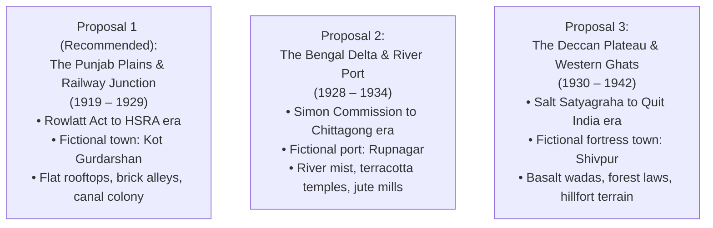

# PROJECT REVOLUTION — World Decisions & Architecture Records

**Author:** Creative Director & Senior Technical Director  
**Project Owner:** Creator (Final Authority on All Decisions)  
**Date:** October 10, 2026  
**Status:** In Progress — Awaiting Creator Decisions on Setting & Period  

---

## 1. Approved Baseline Decisions

| Decision ID | Description | Approved Baseline | Rationale |
| :--- | :--- | :--- | :--- |
| **DEC-001** | Physical Workspace Isolation | `C:\Users\npal7\PROJECT\REVOLUTION` (Outside OneDrive) | Prevents cloud sync locking, file conflicts, and DDC cache churn. |
| **DEC-002** | Target Rendering Pipeline | Unreal Engine 5 with **Lumen Software Ray Tracing** | Supported on NVIDIA GTX 1650 (4 GB VRAM); eliminates hardware RT crashes. |
| **DEC-003** | Compilation Hardware Throttling | `MaxParallelActions: 4` in `BuildConfiguration.xml` | Prevents MSVC linker from exceeding 16 GB system RAM during parallel builds. |
| **DEC-004** | Source Control Baseline | Local Git + Git LFS pointer tracking | Manages binary `.uasset`, `.blend`, `.fbx` assets cleanly without repo bloat. |
| **DEC-005** | Production Staging Model | Staged Prototype $\rightarrow$ Playable Gym $\rightarrow$ Expanding Districts | Avoids building an enormous unvalidated world prematurely. |

---

## 2. Creative Setting Proposals (Awaiting Creator Approval)

### Critical Decision Required:
The Project Owner must select or refine one of the three proposed settings before the full `WORLD_BIBLE.md`, `WORLD_MAP_PLAN.md`, and `ENVIRONMENT_ART_BIBLE.md` are locked.

---

## 3. Open Creative Decisions for Project Owner

1. **Setting Selection:** Which of the three historical settings (Punjab, Bengal, Deccan) shall serve as the anchor for REVOLUTION?
2. **Town Conception:** Do you approve the use of an intensely researched, culturally authentic **fictional town** (e.g., *Kot Gurdarshan* in Punjab or *Rupnagar* in Bengal) to give total narrative freedom while preserving historical integrity?
3. **Protagonist's Family Background:** Should the family be artisans/tradespeople (e.g., a tailor or print shop assistant), a schoolmaster's family, or railway employees? *(Recommendation: A tailor or printing press assistant gives natural mobility and contact with diverse social strata).*
4. **Cinematic Reference Alignment:** Do you approve drawing lighting, emotional restraint, and audio lessons from *Sardar Udham*, *The Legend of Bhagat Singh*, and *Pather Panchali*?

---

## 4. Rejected Alternatives

- **Rejected: Setting the game in modern colonial London or purely metropolitan Calcutta/Bombay for the first prototype.**
  - *Reason:* A massive metropolis has extreme asset production overhead (thousands of unique Victorian facades and dense carriage traffic) that exceeds a small team's capacity and our 4 GB VRAM budget. A regional semi-urban market town with railway and countryside borders provides rich contrast, manageable scale, and deep emotional focus.
- **Rejected: Giving a 12-year-old firearms or superhero martial arts abilities.**
  - *Reason:* Contradicts historical realism and trivializes the human vulnerability of the freedom struggle. Traversal, stealth, agile evasion, eavesdropping, and message-carrying create far more suspenseful and emotionally powerful gameplay.
- **Rejected: Portraying all British characters as identical cartoon villains or all Indian characters as politically united.**
  - *Reason:* History was complex. Indian society had profound internal tensions (loyalists, moderates, radical youth, fearful elders), and colonial administration had varying degrees of bureaucracy, blindness, and brutality. Drama emerges from realistic human conflict.
