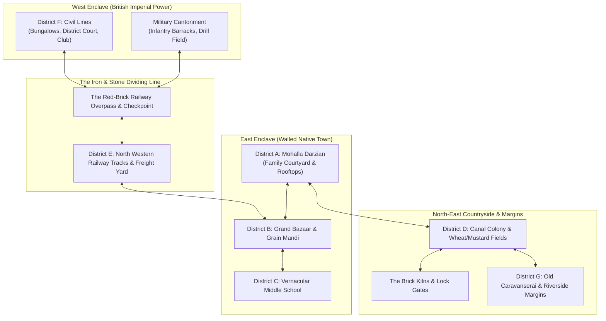
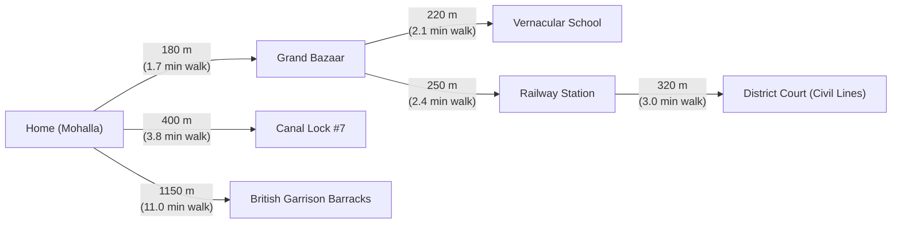
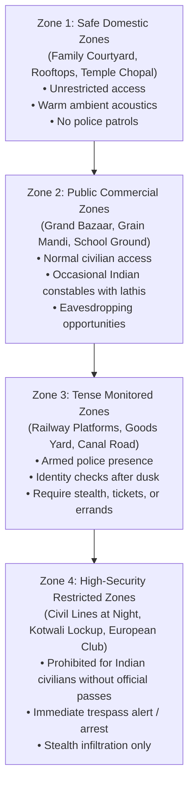
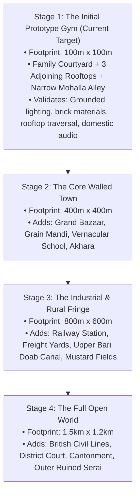

# PROJECT REVOLUTION — World Map Layout & Spatial Design

**World Setting:** Kot Gurdarshan, Central Punjab (1919 – 1929)  
**Total Region Footprint:** $\approx 1.5\text{ km} \times 1.2\text{ km}$ ($1.8\text{ km}^2$ total open-world space)  
**Initial Prototype Footprint:** $100\text{ m} \times 100\text{ m}$ (District A: Family Mohalla & Courtyard)  
**World Streaming Architecture:** Unreal Engine 5 World Partition (512m Grid Cells)  
**Author:** Lead World Designer & Level Designer  
**Date:** October 10, 2026  

---

## 1. High-Level Spatial Layout & Geographic Flow

---

## 2. Landmark Visual Beacons & Lines of Sight

In our environmental design philosophy, open-world navigation relies on visible physical landmarks rather than cluttered mini-map icons. Kot Gurdarshan features five primary visual beacons visible across rooftops and avenues:

| Beacon ID | Landmark Name | Height | District Location | Visual & Narrative Purpose |
| :--- | :--- | :---: | :--- | :--- |
| **LND-01** | **The Railway Station Clock Tower** | $28\text{ m}$ | District E (Junction) | Cast-iron red-brick Victorian tower; chiming bell announces curfew and train arrivals. Visible across all native rooftops. |
| **LND-02** | **The Grand Peepal & Temple Spire** | $22\text{ m}$ | District A (Old Town) | Ancient sprawling sacred tree beside a white lime-shikhara temple; anchor for Kabir's home neighborhood. |
| **LND-03** | **St. Andrew's Garrison Church Spire** | $32\text{ m}$ | District F (Cantonment) | Gothic sandstone spire towering over the British enclave; signals the forbidden European zone. |
| **LND-04** | **Imperial Brick Kiln Chimney** | $35\text{ m}$ | District D (Countryside) | Solitary brick smokestack belching black coal plumes into orange sunset skies; orienting beacon in the countryside. |
| **LND-05** | **The Ruined Caravanserai Mughal Gateway** | $18\text{ m}$ | District G (Outer Margins) | Massive crumbling 17th-century brick archway swallowed by banyan roots; marks the clandestine rebel printer refuge. |

---

## 3. Scale, Distance & Travel Times (12-Year-Old Protagonist)

Movement speeds calibrated for a 12-year-old boy:
- Normal Walking Pace: $3.8\text{ km/h}$ ($\approx 1.05\text{ m/s}$)
- Running / Rooftop Dash: $10.5\text{ km/h}$ ($\approx 2.9\text{ m/s}$)

---

## 4. Security Tiers & Environmental Access Zones

---

## 5. Staged Worldbuilding Rollout Plan

To ensure rigorous quality and prevent unvalidated asset bloat, the world will expand across four controlled stages:

