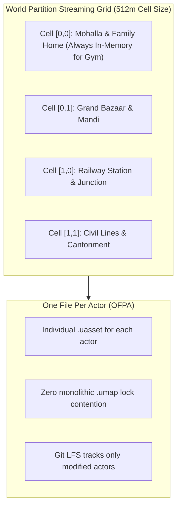
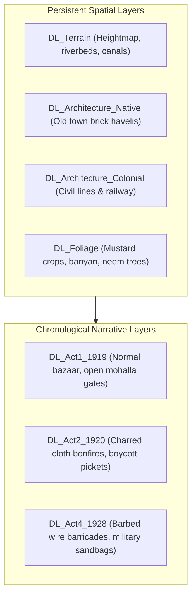

# PROJECT REVOLUTION — World Technical & Engine Architecture Plan

**Target Engine:** Unreal Engine 5.4 / 5.5  
**Target Hardware Baseline:** Intel i5-10200H (4C/8T) | 16 GB RAM | NVIDIA GTX 1650 (4 GB VRAM)  
**Target Visual Fidelity:** Red Dead Redemption 2 Cinematic Standard  
**Author:** Unreal Engine Technical Director & Lead Systems Architect  
**Date:** October 10, 2026  

---

## 1. Unreal Engine 5 World Partition & Streaming Architecture

Kot Gurdarshan covers $1.8\text{ km}^2$ ($1500\text{m} \times 1200\text{m}$). On a 16 GB RAM machine, attempting to load this terrain as a single level would cause fatal out-of-memory crashes. The streaming pipeline is strictly partitioned:

### 1.1 World Partition Parameters:
- **Grid Cell Size:** $512\text{ meters}$ (balances loading frequency against memory footprint).
- **Loading Range:** $650\text{ meters}$ from player camera.
- **HLOD (Hierarchical Level of Detail):** Merged mesh proxies for distant buildings; allows seeing the Railway Clock Tower from $1.2\text{ km}$ away with only 250 triangles and 1 draw call.

---

## 2. Data Layers Architecture (Narrative World States)

Unreal Engine 5 Data Layers will handle both spatial segmentation and **chronological narrative progression**:

When transitioning from 1919 to 1920, the engine simply unloads `DL_Act1_1919` and loads `DL_Act2_1920`. No level reload or map swapping is required.

---

## 3. RDR2 Shading Pipeline on GTX 1650 (4 GB VRAM)

### Technical Optimization Parameters:
1. **Lumen Software Ray Tracing:**
   - Enforce Software Ray Tracing (`r.Lumen.HardwareRayTracing=0`).
   - Screen probe gather downsample factor set to 16 to save 200 MB VRAM.
2. **Temporal Super Resolution (TSR):**
   - Viewport renders internally at $1440 \times 810$ (75% of 1080p) and upscales to native 1080p with temporal accumulation. Delivers crisp RDR2-like hair and fabric fibers with 35% higher framerate.
3. **Dynamic Weather via Material Parameter Collection (`MPC_Weather`):**
   - Single global scalar `Global_RainWetness` ($0.0 \rightarrow 1.0$) smoothly darkens albedo and lowers roughness across all master materials simultaneously during rain.
   - Zero additional memory overhead or bespoke wet shaders.

---

## 4. Hardware Performance Budgets & Profiling Limits

| Engine Metric | Hard Limit Budget | Technical Strategy |
| :--- | :---: | :--- |
| **VRAM Consumption** | $\le 3.5\text{ GB}$ (out of 4.0 GB) | Texture streaming pool capped at 1800 MB; 2K texture maximum. |
| **System RAM** | $\le 12.0\text{ GB}$ (out of 16.0 GB) | World Partition loads max 4 cells at once; unloads distant actors. |
| **Draw Calls Per Frame** | $\le 1,800$ | Modular kit instancing (`InstancedStaticMeshComponent` / Nanite). |
| **Target Frame Rate** | $\ge 30\text{ FPS}$ (Editor) / $\ge 45\text{ FPS}$ (Build) | TSR upscaling + Software Lumen + throttled shadow caching. |
