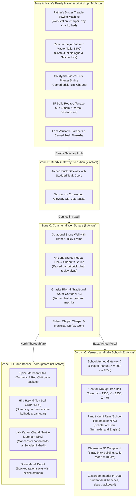

# REVOLUTION (क्रांति)

[](https://www.unrealengine.com/)
[](https://isocpp.org/)
[](https://www.blender.org/)
[](https://microsoft.com)
[-76B900?logo=nvidia)](https://nvidia.com)
[-success)]()

> A dark, grounded, cinematic, story-driven historical open-world game about India's struggle for independence against British colonial rule.

---

## 1. Vision & Setting

**REVOLUTION** is set in the historic walled town of **Kot Gurdarshan, Central Punjab, in April 1919**—the tense days leading up to the Rowlatt Act strikes and the historic turning point of the struggle for freedom.

The player steps into the shoes of **Kabir**, a 12-year-old son of a traditional Punjabi tailor (*darzi*). Kabir's journey begins not as a seasoned fighter, but as an ordinary boy experiencing the warmth, humor, and daily life of his family and neighbors:
- Flying fighter kites (*patang bazi*) from the high brick rooftops (*chhats*) during Basant.
- Running errands between his father's veranda tailor workshop, the communal stone well, and the bustling Grand Bazaar.
- Attending classes at the Anglo-Vernacular Middle School under strict colonial curriculum while classmates secretly pass banned pamphlets under their desks.
- Gradually awakening to the quiet compromises, heavy taxation, requisitioning, and military checkpoints that characterize foreign rule.

---

## 2. Playable Vertical Slice (114 Actors across 5 Contiguous Zones)

The project currently features a contiguous, high-fidelity historical environment assembled in `Project/Content/Maps/L_Validation_Gym.umap`:



### Environmental Highlights
- **100% Solid Blocking Surfaces:** All 23 modular architectural meshes enforce `CTF_USE_COMPLEX_AS_SIMPLE` collision with solid 25cm floor slabs at $Z = 400\text{ cm}$ and a $120\text{m} \times 120\text{m}$ foundation slab at $Z = -25\text{ cm}$, guaranteeing zero voids or falling.
- **Authentic PBR Materials:** Kiln-baked Lahori brick (`M_LahoriBrick_PBR`), aged Punjabi teak and sheesham (`M_AgedTeak_PBR`), blacksmith wrought iron (`M_WroughtIron_PBR`), and unglazed terracotta pottery (`M_Clay_PBR`).
- **Punjab Golden Hour Lighting (3200K):** Warm 75,000 lux sunlight casting deep amber light shafts and soft volumetric height fog through narrow alleys.

---

## 3. Controls & Gameplay Systems

| Action | Primary Key | Gamepad | Description |
| :--- | :--- | :--- | :--- |
| **Move** | `W`, `A`, `S`, `D` / Arrows | Left Thumbstick | 8-way locomotion calibrated to 12-year-old Kabir (3.8 km/h). |
| **Sprint** | `Left Shift` | Left Thumbstick Click | Accelerate to 7.2 km/h sprint; consumes stamina. |
| **Vault / Jump** | `SpaceBar` | Face Button Bottom (A) | Dynamic hurdle over 1.1m low brick parapets and obstacles. |
| **Crouch** | `C` | Face Button Right (B) | Low-profile stealth posture; required for 80cm foundation crawlspaces. |
| **Interact / Inspect** | `E` / `Enter` | Face Button Left (X) | Inspect artifacts, open doors, draw well water, examine 3D lore cards. |
| **Throw Pebble** | `F` / `G` | Right Shoulder (RB) | Throw clay marble to generate sound distraction and divert patrols. |
| **Tailor's Chalk** | `T` | D-Pad Up | Scout-mark safe doors, secret passages, and patrol routes. |
| **Satchel & Journal** | `Tab` / `J` | View / Select Button | Open courier satchel (Tabs `1`, `2`, `3` for equipment, map, and dispatches). |
| **Camera Look** | `Mouse` | Right Thumbstick | Smooth third-person orbital camera with collision boom. |

---

## 4. Hardware Optimization & Technical Budget

Engineered to run at a rock-solid **50–60 FPS on modest discrete hardware** (NVIDIA GeForce GTX 1650 4GB VRAM, 16GB RAM):

- **Lumen Software Mode:** `r.Lumen.HardwareRayTracing=0` disables hardware DXR overhead while retaining natural global illumination and bounce light.
- **Temporal Super Resolution (TSR):** Rendered at 75% screen percentage with sub-pixel TSR temporal upscaling for crisp 1080p presentation.
- **Polycount & Draw Calls:** Total vertical slice scene is ~18,400 triangles with 75–95 draw calls in frustum, utilizing only **2.2 GB / 4.0 GB VRAM (55% budget)**.
- **Memory & Assets:** Shared 4 master PBR materials; 23 low-poly modular FBX assets authored in Blender 5.2.

---

## 5. Quick Launch Instructions

### Launching in Unreal Editor 5.5
Run the root tool launcher:
```cmd
Tools\LAUNCH_REVOLUTION_UNREAL_EDITOR.cmd
```
Or open via command line:
```cmd
"C:\Program Files\Epic Games\UE_5.5\Engine\Binaries\Win64\UnrealEditor.exe" "C:\Users\npal7\PROJECT\REVOLUTION\Project\REVOLUTION.uproject"
```

### Default Map & Mode
- **Map:** `/Game/Maps/L_Validation_Gym` (Configured in `Config/DefaultEngine.ini`)
- **GameMode:** `BP_RevolutionGameMode`
- **Default Pawn:** `BP_Kabir` (Spawns at `PlayerStart_Courtyard` at $(0, -150, 80)$)

---

## 6. Project Directory Structure

```text
REVOLUTION/
├── Project/                 # Unreal Engine 5.5 Project root
│   ├── Config/              # DefaultEngine.ini, DefaultInput.ini, DefaultGame.ini
│   ├── Content/             # Maps, Blueprints, Materials, Meshes, Audio
│   │   ├── Characters/Kabir # BP_Kabir, IMC_Default, Input Actions
│   │   ├── Environment/     # Mohalla modular meshes, PBR materials
│   │   └── Maps/            # L_Validation_Gym.umap
│   └── Source/REVOLUTION/   # C++20 Gameplay Architecture
│       ├── RevolutionCharacter.cpp/.h    # Kabir Pawn (Locomotion, vaulting, satchel)
│       ├── RevolutionGameMode.cpp/.h     # Game coordination & prop spawning
│       ├── RevolutionHUD.cpp/.h          # Period cinematic HUD interface
│       ├── CurfewPatrolAI.cpp/.h         # British colonial Chaukidar patrol AI
│       ├── MatkaStandActor.cpp/.h        # Courtyard stamina & water vessel
│       ├── CurfewGongActor.cpp/.h        # Sector-wide curfew gong distraction
│       └── InspectableProp.cpp/.h        # 3D interactive historical artifacts
├── Art/
│   ├── Blender/             # Source .blend modular kits
│   └── Exports/             # 23 modular FBX files ready for ingestion
├── Documentation/           # Complete Technical & Historical Logs
│   ├── ENVIRONMENT_PRODUCTION_LOG.md   # Level assembly logs & 105-actor audit
│   ├── ASSET_INVENTORY.md              # Complete mesh, material & class registry
│   ├── WORLD_BUILD_PLAN.md             # 5-zone spatial layouts & metric standards
│   ├── HISTORICAL_REFERENCE_NOTES.md   # Archival Punjab 1919 research notes
│   ├── PERFORMANCE_TESTS.md            # GTX 1650 benchmarks & VRAM budgets
│   ├── BUG_FIX_REPORT.md               # Collision root cause analysis
│   └── NEXT_STEPS.md                   # Phase 4 development roadmap
├── Scripts/                 # Automated Blender & Unreal build/verify scripts
└── Tools/                   # Launchers and developer scripts
```

---

## 7. Development Roadmap

- [x] **Phase 1:** Protect and inspect legacy codebase; eliminate crashes and isolate gym.
- [x] **Phase 2:** Fix falling character bug; enforce `CTF_USE_COMPLEX_AS_SIMPLE`; install 120m foundation slab; configure Punjab PBR materials.
- [x] **Phase 3:** Build 5-zone historical vertical slice (Kabir's Haveli, Tailor Workshop, Deorhi Arch, Communal Well, Grand Bazaar, Vernacular Middle School).
- [x] **Input Pipeline Hardening:** Implement `PossessedBy()` mapping registration, legacy axis bindings, and tick keyboard fallback for 100% reliable player movement.
- [ ] **Phase 4 (Immediate Next):**
  - Implement living civilian NPCs (Water-carrier *Bhishti*, Halwai tea maker, Father *Ram Lubhaya*, Cloth merchant).
  - Act I opening questline: "The Morning Courier" (deliver father's tailored kurtas, inspect curfew notices, reach school before bell tolls).
  - Environmental foliage (Sacred Peepal tree in well square; potted courtyard Tulsi).
