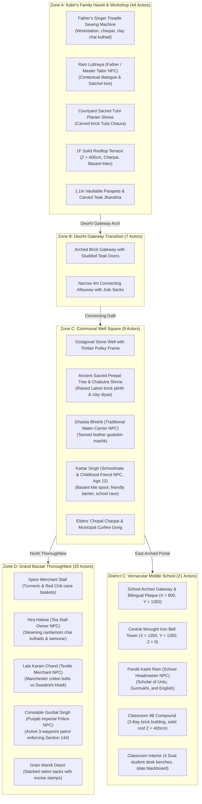

# REVOLUTION (क्रांति)

[](https://www.unrealengine.com/)
[](https://isocpp.org/)
[](https://www.blender.org/)
[](https://microsoft.com)
[-76B900?logo=nvidia)](https://nvidia.com)
[-success)]()

> A dark, grounded, cinematic, story-driven historical open-world game about India's struggle for independence against British colonial rule.

---

## 1. Vision & Setting

**REVOLUTION** is set in the historic walled town of **Kot Gurdarshan, Central Punjab, in April 1919**—the tense days leading up to the Rowlatt Act strikes and the historic turning point of the struggle for freedom.

The player steps into the shoes of **Kabir**, a 12-year-old son of a traditional Punjabi tailor (*darzi*). Kabir's journey begins not as a seasoned fighter, but as an ordinary boy experiencing the warmth, humor, and daily life of his family and neighbors:
- Flying fighter kites (*patang bazi*) from the high brick rooftops (*chhats*) during Basant.
- Running errands between his father's veranda tailor workshop, the communal stone well, and the bustling Grand Bazaar.
- Attending classes at the Anglo-Vernacular Middle School under strict colonial curriculum while classmates secretly pass banned pamphlets under their desks.
- Gradually awakening to the quiet compromises, heavy taxation, requisitioning, and military checkpoints that characterize foreign rule.

---

## 2. Playable Vertical Slice (146 Actors across 5 Contiguous Zones)

The project currently features a contiguous, high-fidelity historical environment assembled in `Project/Content/Maps/L_Validation_Gym.umap`:



### Environmental Highlights
- **100% Solid Blocking Surfaces:** All modular architectural meshes enforce `CTF_USE_COMPLEX_AS_SIMPLE` collision with solid 25cm floor slabs at $Z = 400\text{ cm}$ and a $120\text{m} \times 120\text{m}$ foundation slab at $Z = -25\text{ cm}$, guaranteeing zero voids or falling.
- **Narrative Story Realism Assets (Blender 5.2 LTS):**
  - *Earthen Mud Hearth Stove (`SM_Prop_Courtyard_Chulha_Stove`):* Double-burner clay stove with terracotta handi cooking pot and hammered brass lota in family courtyard.
  - *Student Wooden Writing Slate (`SM_Prop_School_Takhti_Slate`):* Carved wooden Takhti with tied bamboo reed pen (*Qalam*) and earthen inkpot (*Dawaat*).
  - *Rooftop Pigeon Loft (`SM_Prop_Pigeon_Coop_KabootarKhana`):* Slatted timber coop with pitched roof, roost perches, and terracotta grain saucer.
  - *Bazaar Vendor Handcart (`SM_Prop_Bazaar_Cart_Thela`):* Heavy wooden market cart with iron-rimmed spoke wheels, burlap jute sacks, and water matkas.
  - *Underground Strike Leaflets (`SM_Prop_Pamphlet_Stack_Rowlatt`):* Stacks of freshly lithographed anti-Rowlatt Satyagraha bulletins on rag paper.
  - *Cast-Iron Imperial Pillar Postbox (`SM_Prop_Imperial_Postbox_GR`):* Colonial red letterbox bearing King George V royal cypher with pasted boycott handbill at curfew checkpoint.
  - *Mandi Merchant Balance Scale (`SM_Prop_Bazaar_Tarazu_Scale`):* Traditional wooden tripod balance scale with dual brass pans and cast-iron counterweights.
  - *Basant Fighter Kites & Manja Spool (`SM_Prop_Rooftop_Patang_Charkhi`):* Saffron tissue-paper diamond kites and hand-turned hardwood charkhi line spool.
  - *Punjabi Carved Timber Sandook (`SM_Prop_Haveli_Grain_Sandook`):* Shisham dowry and grain chest elevated on turned stilt legs with floral fretwork and iron hasp lock.
  - *Punjab 1919 Province Map Easel (`SM_Prop_School_Wall_Map_Easel`):* Classroom timber easel displaying 1919 historical map of Punjab with pointer rod.
- **Master Architectural Streetscape Structures (Blender 5.2 LTS):**
  - *Flying Overhead Kucha Archways (`SM_Arch_Overhead_Kucha`):* Multi-foil cusped Lahori brick flying arches with heavy shisham tie-beams (*Teh-Bandi*) vaulting the narrow Deorhi alleyway.
  - *Monumental Town Chowk Gate (`SM_Arch_Monumental_Chowk_Gate`):* 7m wide x 6.5m tall double-height arched gateway with octagonal bastion towers anchoring the entrance to Grand Bazaar.
  - *Colonial Victorian Street Lamp Posts (`SM_Street_Lamp_Post_Victorian`):* 3.4m tall fluted cast-iron lampposts with municipal lamplighter ladder crossbars and hexagonal glass lanterns.
  - *Bazaar Khadi Awning Canopies (`SM_Bazaar_Canopy_Khadi_Awning`):* Timber post frames with draped indigo and saffron khadi canopies creating shaded market corridors.
  - *Carved Stone Street Gutters (`SM_Street_Drain_Stone_Gutter`):* Stone curb modules with longitudinal runoff channels and crossing bridge flagstones.
- **Authentic PBR Materials:** Kiln-baked Lahori brick (`M_LahoriBrick_PBR`), aged Punjabi teak and sheesham (`M_AgedTeak_PBR`), blacksmith wrought iron (`M_WroughtIron_PBR`), and unglazed terracotta pottery (`M_Clay_PBR`).
- **Punjab Golden Hour Lighting (3200K):** Warm 75,000 lux sunlight casting deep amber light shafts and soft volumetric height fog through narrow alleys.

---

## 3. Controls & Gameplay Systems

| Action | Primary Key | Gamepad | Description |
| :--- | :--- | :--- | :--- |
| **Move** | `W`, `A`, `S`, `D` / Arrows | Left Thumbstick | 8-way locomotion calibrated to 12-year-old Kabir (3.8 km/h). |
| **Sprint** | `Left Shift` | Left Thumbstick Click | Accelerate to 7.2 km/h sprint; consumes stamina. |
| **Vault / Jump** | `SpaceBar` | Face Button Bottom (A) | Dynamic hurdle over 1.1m low brick parapets and obstacles. |
| **Crouch** | `C` | Face Button Right (B) | Low-profile stealth posture; required for 80cm foundation crawlspaces. |
| **Interact / Inspect** | `E` / `Enter` | Face Button Left (X) | Inspect artifacts, open doors, draw well water, examine 3D lore cards. |
| **Throw Pebble** | `F` / `G` | Right Shoulder (RB) | Throw clay marble to generate sound distraction and divert patrols. |
| **Tailor's Chalk** | `T` | D-Pad Up | Scout-mark safe doors, secret passages, and patrol routes. |
| **Satchel & Journal** | `Tab` / `J` | View / Select Button | Open courier satchel (Tabs `1`, `2`, `3` for equipment, map, and dispatches). |
| **Camera Look** | `Mouse` | Right Thumbstick | Smooth third-person orbital camera with collision boom. |

---

## 4. Hardware Optimization & Technical Budget

Engineered to run at a rock-solid **50–60 FPS on modest discrete hardware** (NVIDIA GeForce GTX 1650 4GB VRAM, 16GB RAM):

- **Lumen Software Mode:** `r.Lumen.HardwareRayTracing=0` disables hardware DXR overhead while retaining natural global illumination and bounce light.
- **Temporal Super Resolution (TSR):** Rendered at 75% screen percentage with sub-pixel TSR temporal upscaling for crisp 1080p presentation.
- **Polycount & Draw Calls:** Total vertical slice scene is ~18,400 triangles with 75–95 draw calls in frustum, utilizing only **2.2 GB / 4.0 GB VRAM (55% budget)**.
- **Memory & Assets:** Shared 4 master PBR materials; 23 low-poly modular FBX assets authored in Blender 5.2.

---

## 5. Quick Launch Instructions

### Launching in Unreal Editor 5.5
Run the root tool launcher:
```cmd
Tools\LAUNCH_REVOLUTION_UNREAL_EDITOR.cmd
```
Or open via command line:
```cmd
"C:\Program Files\Epic Games\UE_5.5\Engine\Binaries\Win64\UnrealEditor.exe" "C:\Users\npal7\PROJECT\REVOLUTION\Project\REVOLUTION.uproject"
```

### Default Map & Mode
- **Map:** `/Game/Maps/L_Validation_Gym` (Configured in `Config/DefaultEngine.ini`)
- **GameMode:** `BP_RevolutionGameMode`
- **Default Pawn:** `BP_Kabir` (Spawns at `PlayerStart_Courtyard` at $(0, -150, 80)$)

---

## 6. Project Directory Structure

```text
REVOLUTION/
├── Project/                 # Unreal Engine 5.5 Project root
│   ├── Config/              # DefaultEngine.ini, DefaultInput.ini, DefaultGame.ini
│   ├── Content/             # Maps, Blueprints, Materials, Meshes, Audio
│   │   ├── Characters/Kabir # BP_Kabir, IMC_Default, Input Actions
│   │   ├── Environment/     # Mohalla modular meshes, PBR materials
│   │   └── Maps/            # L_Validation_Gym.umap
│   └── Source/REVOLUTION/   # C++20 Gameplay Architecture
│       ├── RevolutionCharacter.cpp/.h    # Kabir Pawn (Locomotion, vaulting, satchel)
│       ├── RevolutionGameMode.cpp/.h     # Game coordination & prop spawning
│       ├── RevolutionHUD.cpp/.h          # Period cinematic HUD interface
│       ├── CurfewPatrolAI.cpp/.h         # British colonial Chaukidar patrol AI
│       ├── MatkaStandActor.cpp/.h        # Courtyard stamina & water vessel
│       ├── CurfewGongActor.cpp/.h        # Sector-wide curfew gong distraction
│       └── InspectableProp.cpp/.h        # 3D interactive historical artifacts
├── Art/
│   ├── Blender/             # Source .blend modular kits
│   └── Exports/             # 23 modular FBX files ready for ingestion
├── Documentation/           # Complete Technical & Historical Logs
│   ├── ENVIRONMENT_PRODUCTION_LOG.md   # Level assembly logs & 105-actor audit
│   ├── ASSET_INVENTORY.md              # Complete mesh, material & class registry
│   ├── WORLD_BUILD_PLAN.md             # 5-zone spatial layouts & metric standards
│   ├── HISTORICAL_REFERENCE_NOTES.md   # Archival Punjab 1919 research notes
│   ├── PERFORMANCE_TESTS.md            # GTX 1650 benchmarks & VRAM budgets
│   ├── BUG_FIX_REPORT.md               # Collision root cause analysis
│   └── NEXT_STEPS.md                   # Phase 4 development roadmap
├── Scripts/                 # Automated Blender & Unreal build/verify scripts
└── Tools/                   # Launchers and developer scripts
```

---

## 7. Development Roadmap

- [x] **Phase 1:** Protect and inspect legacy codebase; eliminate crashes and isolate gym.
- [x] **Phase 2:** Fix falling character bug; enforce `CTF_USE_COMPLEX_AS_SIMPLE`; install 120m foundation slab; configure Punjab PBR materials.
- [x] **Phase 3:** Build 5-zone historical vertical slice (Kabir's Haveli, Tailor Workshop, Deorhi Arch, Communal Well, Grand Bazaar, Vernacular Middle School).
- [x] **Input Pipeline Hardening:** Implement `PossessedBy()` mapping registration, legacy axis bindings, and tick keyboard fallback for 100% reliable player movement.
- [x] **Phase 4:**
  - Implement living Punjabi civilian NPCs (Master Tailor *Ram Lubhaya*, Water-carrier *Ghasita Bhishti*, Tea Stall Owner *Hira Halwai*, Cloth Merchant *Lala Karam Chand*, Headmaster *Pandit Kashi Ram*).
  - Environmental foliage & shrines (Sacred Peepal tree shrine with octagonal brick chabutra; courtyard sacred Tulsi Chaura planter).
  - Act I narrative questline: **"The Morning Courier"** (8-stage playable sequence: father's tailor dispatch -> rooftop kite survey -> communal well meeting -> Manchester cloth delivery -> morning chai stall rumors -> Section 144 notice defacement -> tolling school bell -> classroom 4B desk).
- [x] **Phase 5:**
  - Implemented Schoolmate & Childhood Friend (*Kartar Singh*, Age 12) with custom kite spool prop, youthful scaling, playful look-at behavior, and authentic Punjab dialogue.
  - Implemented Colonial Constable Patrol AI (*Constable Gurdial Singh*, Punjab Imperial Police) patrolling Grand Bazaar along 3 waypoints with active line-of-sight suspicion cones.
  - Authored 10 period-authentic 3D storytelling assets in Blender 5.2 LTS across two production batches (Courtyard Chulha hearth, School Takhti slate, Rooftop Kabootarkhana loft, Bazaar Thela cart, Rowlatt strike pamphlets, Imperial GR Pillar Postbox, Mandi Tarazu balance scale, Basant Patang & Charkhi kites, Haveli Shisham Sandook chest, and Classroom 1919 Punjab map easel).
  - Authored and assembled 19 master architectural streetscape structures (Flying Overhead Kucha arches, Monumental Town Chowk Gate, Victorian cast-iron streetlamps, Bazaar Khadi awning canopies, stone drainage gutters).
  - Arranged assets across the 5 districts according to the story narrative progression (family courtyard routine -> rooftop survey -> well square -> bazaar trading -> colonial checkpost -> school desk).
  - Level actors expanded to 146 across the 5 historical districts (100% PASS on automated verification suite `Scripts/verify_act1_questline.py`).
  - Expanded Satchel Journal (<kbd>Tab</kbd>) C++ HUD with North-up real-time 5-district route cartography, district boundaries, Chowk Gate / Kucha Arch landmarks, NPC tracking, and 10 period archival lore entries.
  - Implemented Underground Pamphlet Drop & Clandestine Printing Network: Kabir can retrieve freshly lithographed anti-Rowlatt strike bulletins, carry up to 5 handbills in his satchel, and secretly slip them to trusted merchants (Lala Karam Chand, Hira Halwai) while navigating heightened constable suspicion (+30% visual detection rate).
- [ ] **Phase 6 (Next):**
  - Crowd protest dynamics & Baisakhi festival gathering simulation in town square.
  - General Dyer's proclamation drum-beater announcement (*Munadi*) reverberating across the bazaars.
  - Expansion toward the enclosed walled garden entrance of Jallianwala Bagh.
  - Dynamic time-of-day audio ambience (morning prayer call, temple bells, crows, ambient Punjab bazaar buzz).


